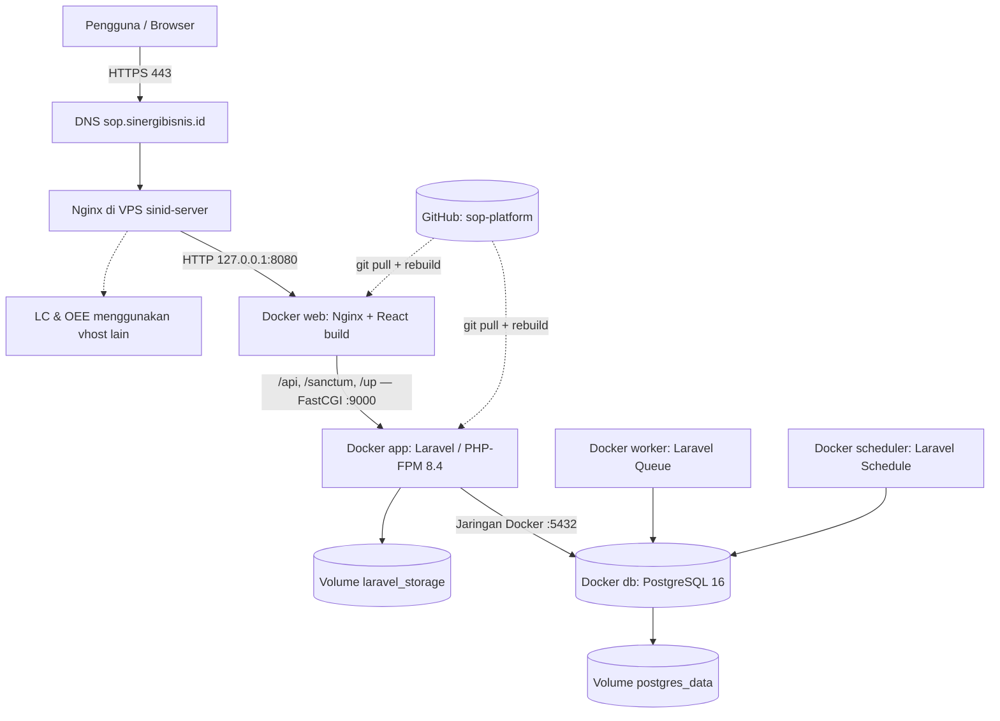
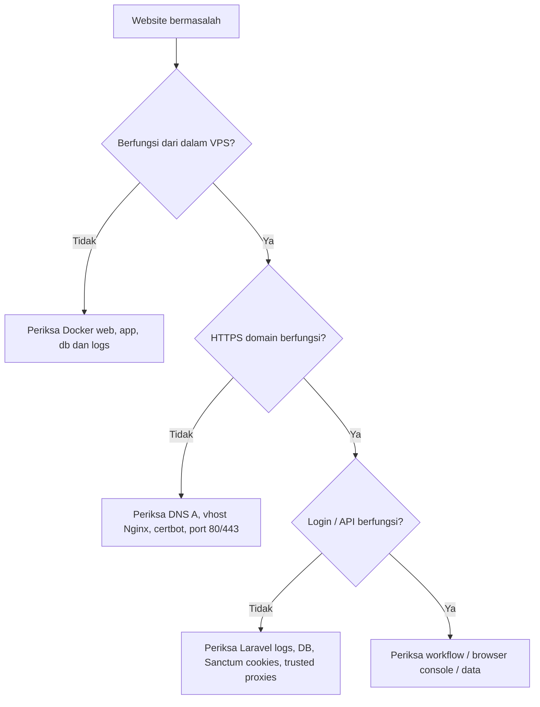

# SOP Platform — Dokumentasi Deployment & Maintenance VPS

> **Runbook operasional • Docker + Laravel + React + PostgreSQL + GitHub + Nginx + HTTPS**  
> **Diperbarui:** 17 Oktober 2026 · **Environment:** VPS `sinid-server` · **Aplikasi:** [sop.sinergibisnis.id](https://sop.sinergibisnis.id)  
> **Repository:** [github.com/noosabaktee/sop-platform](https://github.com/noosabaktee/sop-platform) · **Branch:** `main`
>
> **Status:** Pemilik project telah menyatakan website online. Dokumen ini merekam konfigurasi dan proses yang dipakai dalam percakapan deployment; kondisi server terkini tetap harus diverifikasi memakai perintah pemeriksaan di bawah. Jangan menyalin secret/password ke dokumen atau repository.

[](https://docs.docker.com/) [](https://laravel.com/docs/12.x) [](https://react.dev/) [](https://www.postgresql.org/) [](https://letsencrypt.org/)

> [!IMPORTANT]
> **Lingkungan ini berbagi VPS dengan layanan lain:** `lc.sinergibisnis.id`, `oee.sinergibisnis.id`, dan container SINID. Semua perintah Docker di dokumen ini dijalankan dari `/home/ubuntu/sop-platform` agar dibatasi pada **project Compose SOP**. Jangan menjalankan perintah penghapusan global seperti `docker system prune -a`, `docker volume prune`, atau menghentikan Nginx tanpa rencana.

---

## Navigasi cepat

| Mulai dari sini | Operasional sehari-hari | Jika ada masalah |
|---|---|---|
| [Arsitektur](#1-arsitektur-produksi) | [Perintah cepat](#2-perintah-cepat) | [Troubleshooting](#13-troubleshooting-interaktif) |
| [Detail server](#3-inventaris-dan-konfigurasi) | [Update dari GitHub](#9-maintenance-deploy-perubahan) | [Rollback](#11-rollback-setelah-update-gagal) |
| [Deploy dari nol](#4-deployment-awal-dari-nol) | [Backup & restore](#10-backup-dan-restore) | [Respons insiden](#14-runbook-insiden) |
| [DNS, Nginx & HTTPS](#5-dns-nginx-dan-https) | [Monitoring rutin](#12-jadwal-maintenance) | [FAQ & larangan](#15-faq-dan-perintah-yang-dilarang) |
| [Environment](#6-variabel-environment) | [Git workflow](#8-workflow-git-dan-github) | [Checklist go-live](#16-checklist-verifikasi-akhir) |

<details>
<summary><strong>▶ Checklist 60 detik: kondisi aplikasi sekarang</strong></summary>

Buka **Terminal VS Code — Remote SSH**, lalu jalankan:

```bash
cd /home/ubuntu/sop-platform
pwd
docker compose ps
curl -fsSI http://127.0.0.1:8080/
curl -fsSI https://sop.sinergibisnis.id/
curl -fsS https://sop.sinergibisnis.id/up
```

- [ ] `docker compose ps` menunjukkan `app`, `db`, `web`, `worker`, `scheduler` aktif.
- [ ] `db` menunjukkan `healthy`.
- [ ] Endpoint lokal memberikan respons HTTP yang sesuai (umumnya 200).
- [ ] URL publik memakai HTTPS dan sertifikat valid.
- [ ] `/up` memberikan respons sehat.
- [ ] Login serta simpan/baca satu data uji berhasil.

`/up` hanya memeriksa health Laravel yang dikonfigurasi, **bukan** bukti semua alur bisnis telah diuji.

</details>

---

## 1. Arsitektur produksi



**Pemisahan tanggung jawab:**

| Lapisan | Lokasi | Tugas | Publik? |
|---|---|---|---|
| DNS | Pengelola `sinergibisnis.id` | A record `sop` menuju IP publik VPS | Ya |
| Nginx host | VPS Ubuntu | Virtual host SOP, TLS/HTTPS, reverse proxy | Port 80/443 |
| `web` | Docker Compose | Menyajikan hasil build React, route Laravel via FastCGI | **Loopback** `127.0.0.1:8080` |
| `app` | Docker Compose | Laravel 12, PHP-FPM 8.4, API, Sanctum | Tidak; jaringan Docker |
| `db` | Docker Compose | PostgreSQL 16 dan data aplikasi | Tidak; jaringan Docker |
| `worker` | Docker Compose | Menjalankan queued jobs | Tidak |
| `scheduler` | Docker Compose | Menjalankan Laravel schedule | Tidak |
| `postgres_data` | Docker volume | Menyimpan database lintas restart/rebuild | Tidak |
| `laravel_storage` | Docker volume | Menyimpan file Laravel termasuk upload | Tidak |

**Penting:** Frontend dan API berada pada **origin yang sama** (`https://sop.sinergibisnis.id`). Build React menggunakan `VITE_API_BASE_URL=""`, sehingga browser mengirim request ke `/api` dan `/sanctum` melalui domain yang sama. Konfigurasi ini mendukung autentikasi Laravel Sanctum berbasis cookie.

---

## 2. Perintah cepat

> Semua perintah dalam blok berikut dijalankan pada **terminal VPS**, kecuali yang secara eksplisit diberi label *PowerShell Windows*.

<details open>
<summary><strong>▶ Cek status dan log (aman, read-only)</strong></summary>

```bash
cd ~/sop-platform

docker compose ps
docker compose logs --tail=100 web app db worker scheduler
docker compose logs -f --tail=100 app
sudo nginx -t
sudo systemctl status nginx --no-pager
sudo certbot certificates
```

Tekan `Ctrl+C` untuk keluar dari mode `logs -f` (ini **tidak** menghentikan container).

</details>

<details>
<summary><strong>▶ Restart hanya layanan SOP</strong></summary>

```bash
cd ~/sop-platform
# Restart Laravel saja
docker compose restart app

# Restart frontend / Nginx container SOP saja
docker compose restart web

# Restart worker setelah perubahan kode
docker compose restart worker
```

`restart` **tidak** membangun image baru. Jika source berubah, gunakan prosedur [update dari GitHub](#9-maintenance-deploy-perubahan). `docker compose restart` hanya mempengaruhi service project yang dipilih.

</details>

<details>
<summary><strong>▶ Cek kesehatan website, API dan database</strong></summary>

```bash
cd ~/sop-platform
curl -i http://127.0.0.1:8080/up
curl -i https://sop.sinergibisnis.id/up
curl -I https://sop.sinergibisnis.id/
docker compose exec -T app php artisan migrate:status
docker compose exec -T db sh -c 'pg_isready -U "$POSTGRES_USER" -d "$POSTGRES_DB"'
```

`migrate:status` memeriksa status migrasi dan tidak mengubah database.

</details>

<details>
<summary><strong>▶ Ringkasan lokasi penting</strong></summary>

| Hal | Path / nilai |
|---|---|
| Root repository | `/home/ubuntu/sop-platform` |
| Konfigurasi Compose | `/home/ubuntu/sop-platform/compose.yaml` |
| Environment (secret) | `/home/ubuntu/sop-platform/.env` |
| Dockerfile Laravel | `backend/Dockerfile` |
| Dockerfile frontend | `docker/web.Dockerfile` |
| Nginx dalam container | `docker/nginx.conf` |
| Nginx host SOP | `/etc/nginx/sites-available/sop-platform` |
| Nginx active symlink | `/etc/nginx/sites-enabled/sop-platform` |
| Sertifikat Let's Encrypt | Di bawah `/etc/letsencrypt/` (kelola dengan Certbot) |
| Volume database | Compose volume `postgres_data` |
| Volume upload | Compose volume `laravel_storage` |

</details>

---

## 3. Inventaris dan konfigurasi

| Komponen | Nilai hasil proses deployment | Catatan |
|---|---|---|
| VPS | `sinid-server` | Ubuntu, user SSH `ubuntu` |
| IP privat VPS | `10.0.0.74` | Bisa berubah sesuai jaringan |
| IP publik yang digunakan | `168.110.207.161` | Verifikasi ulang jika IP berubah |
| Domain aplikasi | `sop.sinergibisnis.id` | HTTPS publik |
| Situs lain di VPS | `lc.sinergibisnis.id`, `oee.sinergibisnis.id` | Jangan ubah virtual host-nya |
| Docker Compose yang teramati | `v5.5.1` | Dari terminal pengguna pada 17 Okt 2026 |
| Backend | Laravel 12 + PHP-FPM **8.4** | PHP 8.3 gagal karena `composer.lock` |
| Frontend | React 19 + Vite + Node 22 (build image) | Static output dilayani Nginx |
| Database | PostgreSQL 16 Alpine | Docker volume persisten |
| GitHub | `noosabaktee/sop-platform`, branch `main` | Remote SSH alias `github-sop` |
| Port existing | `80`, `443` (Nginx host), `8008` (OEE) | Tidak boleh diambil alih sembarangan |
| Port SOP | `127.0.0.1:8080` → container `web:80` | Tidak perlu terbuka publik |

**Struktur yang relevan:**

```text
/home/ubuntu/sop-platform/
├── backend/
│   ├── Dockerfile                    # PHP 8.4 + Composer + ekstensi PostgreSQL
│   ├── app/
│   ├── bootstrap/app.php             # routing / trusted proxies
│   ├── database/migrations/
│   └── composer.lock
├── frontend/
│   ├── src/
│   ├── package.json
│   └── package-lock.json
├── docker/
│   ├── nginx.conf                    # Nginx container, FastCGI ke Laravel
│   └── web.Dockerfile                # Build React, lalu Nginx
├── compose.yaml                     # app, db, web, worker, scheduler
├── .env                             # SECRET; jangan commit
└── .env.docker.example              # Template placeholder saja
```

> [!NOTE]
> Repository publik aslinya pernah didokumentasikan untuk **setup lokal tanpa Docker**. File Compose/Docker ini adalah **konfigurasi deployment tambahan**; jangan mengikuti perintah `migrate:fresh` dari panduan development pada database produksi.

---

## 4. Deployment awal dari nol

Bagian ini adalah **rekonstruksi langkah instalasi awal**. Jika SOP Platform sudah online, **jangan menjalankannya ulang tanpa kebutuhan**.

### 4.1 Masuk VPS melalui VS Code Remote SSH

1. Install ekstensi **Remote - SSH** dari Microsoft pada VS Code Windows.
2. Tambahkan alias VPS pada `C:\Users\<USER>\.ssh\config` menggunakan **private key lokal** yang memang dipakai untuk login VPS.
3. Jalankan `Remote-SSH: Connect to Host...` → alias `sinid-server`.
4. Buka folder `/home/ubuntu/sop-platform`.

**Contoh SSH config (placeholder):**

```sshconfig
Host sinid-server
    HostName <IP_ATAU_HOST_SSH_YANG_BISA_DIAKSES>
    User ubuntu
    Port 22
    IdentityFile C:/Users/<USER>/.ssh/<PRIVATE_KEY_VPS>
    IdentitiesOnly yes
```

> Jangan unggah private key VPS, GitHub private key, atau passphrase ke repository.

### 4.2 Docker dan Git

Jika Docker belum terpasang, instal Docker Engine + Compose plugin **dari repositori resmi Docker untuk Ubuntu**; pada server ini Docker sudah terpasang, sehingga pemeriksaan cukup:

```bash
docker --version
docker compose version
docker ps
git --version
```

Jika aplikasi lain tampak pada `docker ps`, **jangan** menghentikan atau menghapusnya.

### 4.3 SSH GitHub dari VPS

SSH key untuk **VPS → GitHub** berbeda dari SSH key untuk **Windows → VPS**.

```bash
ssh-keygen -t ed25519 -f ~/.ssh/id_ed25519_github_sop -C 'sinid-server-github'
cat ~/.ssh/id_ed25519_github_sop.pub
```

- Tempel isi **public key** `.pub` di GitHub → repository `sop-platform` → **Settings → Deploy keys**.
- Untuk VPS yang hanya deploy, biarkan **read-only**. Izin **Allow write access** hanya jika benar-benar akan `git push` dari VPS (risiko lebih tinggi jika server dibobol).
- Simpan private key hanya di VPS, bukan dalam repository.

Konfigurasikan alias `~/.ssh/config` (tambahkan, jangan menimpa host lain):

```sshconfig
Host github-sop
    HostName github.com
    User git
    IdentityFile ~/.ssh/id_ed25519_github_sop
    IdentitiesOnly yes
```

```bash
chmod 700 ~/.ssh
chmod 600 ~/.ssh/config ~/.ssh/id_ed25519_github_sop
ssh -T git@github-sop
```

Pertama kali tersambung, **bandingkan fingerprint host GitHub dengan daftar resmi GitHub** sebelum mengetik `yes`. Pesan `successfully authenticated` menandakan SSH berhasil walaupun GitHub tidak menyediakan interactive shell.

Clone:

```bash
cd /home/ubuntu
git clone git@github-sop:noosabaktee/sop-platform.git
cd sop-platform
git remote -v
git branch --show-current
```

### 4.4 Siapkan berkas Docker

Berkas deployment yang dipakai:

```text
compose.yaml
.env.docker.example
.dockerignore
backend/Dockerfile
backend/.dockerignore
docker/nginx.conf
docker/web.Dockerfile
```

Simpan file-file tersebut di path masing-masing. Pada proses sebelumnya paket ZIP diunggah dari PowerShell Windows dengan `scp`, lalu diekstrak ke root repo. **Tinjau isi ZIP sebelum mengekstrak** dan jangan menimpa konfigurasi yang sudah dimodifikasi tanpa backup.

```powershell
# PowerShell Windows — CONTOH; sesuaikan path ZIP
scp "C:\Users\<USER>\Downloads\sop-platform-docker-deploy.zip" sinid-server:~/
```

```bash
# Terminal VPS — CONTOH deployment awal
cd ~/sop-platform
unzip -l ~/sop-platform-docker-deploy.zip
unzip ~/sop-platform-docker-deploy.zip -d ~/sop-platform
```

**Perbaikan yang benar-benar dibutuhkan:** image Docker Laravel **harus PHP 8.4**, bukan 8.3. Di `backend/Dockerfile`:

```dockerfile
FROM php:8.4-fpm-bookworm
```

Penyebabnya, beberapa dependency yang dikunci pada `backend/composer.lock`, antara lain Symfony 8.1, mensyaratkan PHP `>=8.4.1`. **Jangan** memperbaikinya dengan `composer update` spontan atau `--ignore-platform-reqs` di produksi.

### 4.5 Konfigurasi `.env` dan jalankan stack

Lihat [bagian 6](#6-variabel-environment), lalu:

```bash
cd ~/sop-platform
cp .env.docker.example .env      # hanya pada instalasi awal; jangan menimpa .env aktif
nano .env
chmod 600 .env
docker compose config --quiet
docker compose up -d --build db app web
docker compose ps
```

Buat `APP_KEY` hanya **sekali** dengan `openssl rand -base64 32`, lalu isi `APP_KEY=base64:<HASIL>`. Periksa semua placeholder dan secret sebelum pertama kali menjalankan Docker.

Untuk database baru yang kosong:

```bash
docker compose exec app php artisan migrate --force
# Seeder HANYA jika diperlukan di database baru yang memang kosong:
# docker compose exec app php artisan db:seed --force
# Jika aplikasi perlu mengakses upload publik:
# docker compose exec app php artisan storage:link

docker compose up -d worker scheduler
```

**Jangan gunakan seeder untuk mengisi ulang produksi tanpa mengaudit implementasinya.** Jika ada user demo, nonaktifkan/ganti kredensial sebelum dipakai nyata.

---

## 5. DNS, Nginx, dan HTTPS

### 5.1 DNS subdomain

Di panel DNS `sinergibisnis.id`, buat atau verifikasi:

| Type | Name | Value | TTL |
|---|---|---|---|
| `A` | `sop` | `168.110.207.161` | Auto/default |

Jika memakai Cloudflare, saat awal issuance sertifikat gunakan **DNS Only** hingga origin dapat divalidasi; setelah itu perubahan proxy memerlukan evaluasi TLS tersendiri. Jangan mengubah record `lc` atau `oee`. Jika memiliki AAAA (IPv6), pastikan IP IPv6 memang mengarah ke server yang benar.

Periksa:

```bash
dig +short A sop.sinergibisnis.id @1.1.1.1
dig +short AAAA sop.sinergibisnis.id @1.1.1.1
```

### 5.2 Backup Nginx host sebelum perubahan

```bash
sudo tar -czf /root/nginx-backup-$(date +%Y%m%d-%H%M%S).tar.gz -C /etc nginx
sudo nginx -t
sudo nginx -T 2>/dev/null | grep -n 'server_name'
```

Ada vhost existing untuk **LC** dan **OEE**. **Jangan edit atau hapus file keduanya**.

### 5.3 Virtual host SOP khusus (HTTP awal)

File: `/etc/nginx/sites-available/sop-platform`.

```nginx
server {
    listen 80;
    server_name sop.sinergibisnis.id;

    client_max_body_size 20M;
    access_log /var/log/nginx/sop-platform-access.log;
    error_log /var/log/nginx/sop-platform-error.log;

    location / {
        proxy_pass http://127.0.0.1:8080;
        proxy_http_version 1.1;
        proxy_set_header Host $host;
        proxy_set_header X-Real-IP $remote_addr;
        proxy_set_header X-Forwarded-For $proxy_add_x_forwarded_for;
        proxy_set_header X-Forwarded-Proto $scheme;
        proxy_set_header X-Forwarded-Host $host;
        proxy_connect_timeout 30s;
        proxy_read_timeout 120s;
    }
}
```

Aktifkan sekali saja (jika symlink belum ada):

```bash
sudo ln -s /etc/nginx/sites-available/sop-platform /etc/nginx/sites-enabled/sop-platform
sudo nginx -t
# JALANKAN HANYA jika nginx -t sukses:
sudo systemctl reload nginx
```

> `nginx -t` + `reload` dilakukan pada **Nginx host**, bukan pada container `web`. Jika nama host bentrok, hentikan perubahan dan periksa `sites-enabled` sebelum reload.

### 5.4 Pasang HTTPS dan redirect

Setelah DNS A benar dan HTTP publik mencapai vhost SOP:

```bash
sudo apt update
sudo apt install -y certbot python3-certbot-nginx
sudo certbot --nginx -d sop.sinergibisnis.id --redirect
sudo nginx -t
sudo certbot certificates
sudo certbot renew --dry-run
```

**Setelah Certbot, konfigurasi Nginx di disk mungkin tidak lagi sama persis dengan contoh HTTP di atas:** Certbot dapat menambah blok TLS `listen 443 ssl` dan redirect 80→443. Perlakukan file hasil Certbot sebagai konfigurasi aktif, jangan menimpa dengan contoh lama.

Cek:

```bash
curl -I http://sop.sinergibisnis.id/
curl -I https://sop.sinergibisnis.id/
curl -i https://sop.sinergibisnis.id/up
```

### 5.5 Batasi Docker port 8080 ke loopback

Di `.env` root:

```dotenv
HTTP_BIND=127.0.0.1
HTTP_PORT=8080
```

Terapkan perubahan Compose:

```bash
cd ~/sop-platform
docker compose up -d
docker compose ps
```

Port `web` yang benar:

```text
127.0.0.1:8080->80/tcp
```

Sekarang port 8080 hanya untuk koneksi lokal dari Nginx VPS; browser publik memakai port **443** melalui subdomain.

---

## 6. Variabel environment

**File yang dipakai oleh Docker Compose dan Laravel:** `/home/ubuntu/sop-platform/.env`. Tidak perlu memakai `backend/.env` terpisah untuk container pada paket Compose ini.

> [!CAUTION]
> **Jangan commit file `.env`, private key, token API, password database, backup database, atau hasil `docker compose config` yang memuat secret.** Jangan mengganti `APP_KEY` setelah aplikasi punya pengguna/data: data terenkripsi dan sesi bisa terdampak. Jangan mengganti kredensial `POSTGRES_*` pada volume yang sudah terinisialisasi tanpa prosedur perubahan password/database yang benar.

**Template konfigurasi produksi (placeholder, bukan kredensial asli):**

```dotenv
APP_NAME="SOP Platform"
APP_ENV=production
APP_DEBUG=false
APP_KEY=base64:<KUNCI_TETAP_YANG_SUDAH_DIBUAT>
APP_URL=https://sop.sinergibisnis.id

HTTP_BIND=127.0.0.1
HTTP_PORT=8080

DB_CONNECTION=pgsql
DB_HOST=db
DB_PORT=5432
DB_DATABASE=sop_platform
DB_USERNAME=sop_user
DB_PASSWORD=<PASSWORD_DB_KUAT>

SESSION_DRIVER=database
SESSION_DOMAIN=
SESSION_SECURE_COOKIE=true
SANCTUM_STATEFUL_DOMAINS=sop.sinergibisnis.id
FRONTEND_ORIGINS=https://sop.sinergibisnis.id

CACHE_STORE=database
QUEUE_CONNECTION=database
LOG_CHANNEL=stderr
MAIL_MAILER=log
SOP_SEED_PASSWORD=<HANYA_UNTUK_INITIAL_SEED_JIKA_DIPERLUKAN>
```

| Variabel | Alasan / aturan |
|---|---|
| `APP_URL` | URL publik yang **persis** dipakai browser, wajib HTTPS |
| `APP_DEBUG` | `false` di publik untuk mencegah informasi internal bocor |
| `APP_KEY` | Dibuat sekali, disimpan aman dan di-backup, **jangan regenerate rutin** |
| `DB_HOST` | `db`, yaitu DNS service Docker, **bukan** `localhost` |
| `DB_PORT` | `5432` hanya dalam jaringan Docker |
| `DB_*` | Harus sesuai saat volume PostgreSQL pertama kali dibuat |
| `HTTP_BIND` | `127.0.0.1` agar port Docker tidak diekspos ke internet |
| `SANCTUM_STATEFUL_DOMAINS` | Domain saja tanpa `https://`; sertakan port hanya jika origin non-standar |
| `SESSION_SECURE_COOKIE` | `true` ketika menggunakan HTTPS |
| `FRONTEND_ORIGINS` | `https://sop.sinergibisnis.id` |
| `MAIL_MAILER=log` | **Email belum benar-benar dikirim**; perlu provider SMTP/mail bila fitur email dipakai |
| `SOP_SEED_PASSWORD` | Hanya untuk seeding awal; hindari akun demo aktif di production |

> **Trusted proxies:** Karena ada Nginx host → Nginx container → Laravel, periksa konfigurasi trusted proxy Laravel (`backend/bootstrap/app.php`) bila Laravel menganggap request HTTPS sebagai HTTP (redirect salah, cookie Secure tidak benar, atau login gagal). Percayai **proxy/jaringan Docker yang spesifik**, bukan sembarang IP internet. Perubahan kode ini perlu build ulang image `app`.

**Keamanan file:**

```bash
cd ~/sop-platform
chmod 600 .env
# Pastikan .env di-ignore sebelum commit:
git check-ignore -v .env
```

Jika `git check-ignore` tidak mengembalikan apa pun, perbaiki `.gitignore` **sebelum** `git add`/`git push`.

---

## 7. GitHub dan sumber kode

Repository: <https://github.com/noosabaktee/sop-platform>. Konvensi yang disarankan:

- **Pengembangan di komputer / branch fitur** → review → merge ke `main` → **VPS melakukan pull + rebuild**.
- Jika VPS diberi izin push, batasi hanya pada perbaikan yang disetujui dan hindari perubahan kode produksi langsung tanpa review.
- **.env dan backup bukan bagian Git**. File Docker/Nginx container boleh di-versioning setelah diverifikasi; konfigurasi Nginx host dan private key harus dikelola terpisah.

Periksa remote:

```bash
cd ~/sop-platform
git remote -v
git branch --show-current
git status --short
```

Untuk repo yang sudah disiapkan, remote dapat memakai alias SSH:

```text
origin  git@github-sop:noosabaktee/sop-platform.git
```

Jika file Docker masih *untracked* di VPS, sebelum deploy update tentukan apakah akan di-commit ke Git atau tetap dikelola terpisah; `git pull` bisa gagal bila file remote memiliki nama yang sama.

---

## 8. Workflow Git dan GitHub

### 8.1 Dari komputer pengembang (disarankan)

```bash
git switch -c feat/nama-fitur
# Edit source dan jalankan pengujian
git status --short
git add frontend/src/ backend/app/  # CONTOH: pilih file yang memang berubah
git commit -m 'feat: perbaiki modul SOP'
git push -u origin feat/nama-fitur
```

Buat Pull Request, review, kemudian merge ke `main`. Jangan menjalankan `git add -A` secara membabi buta pada VPS yang memiliki `.env` dan file backup.

### 8.2 Jika memang perlu push dari VPS

Pastikan deploy key GitHub **memiliki write access**, lalu:

```bash
cd ~/sop-platform
git status --short
# Tambahkan path spesifik yang aman, bukan .env:
git add backend/app/ frontend/src/
git diff --cached --stat
git commit -m 'fix: koreksi aplikasi SOP'
git push origin main
```

Lebih baik gunakan branch dan Pull Request. Jika push ditolak, periksa izin key, protection rules branch, serta apakah remote sudah berubah; **jangan** langsung memakai `--force`.

### 8.3 Sinkronisasi VPS sesudah perubahan

Gunakan prosedur deploy terkendali di bagian berikut. `git pull` saja **belum cukup**, karena React dibuild menjadi static asset dan PHP package masuk ke image Docker.

---

## 9. Maintenance: deploy perubahan

### 9.1 Checklist sebelum update

- [ ] Ada commit/PR yang jelas untuk dirilis.
- [ ] Fitur utama lolos pengujian di environment pengembangan atau staging.
- [ ] Perubahan migration **non-destruktif**, atau sudah ada rencana migrasi data.
- [ ] Database dan file upload sudah dibackup, terutama jika ada migration.
- [ ] `git status --short` VPS bersih, atau perubahan lokal sudah dicatat/diamankan.
- [ ] Tersedia waktu maintenance dan rencana rollback.
- [ ] Tidak ada job penting yang harus berjalan tanpa jeda.

### 9.2 Prosedur update normal

```bash
cd ~/sop-platform

# 1. Catat versi sebelum update
git rev-parse HEAD

# 2. Cek perubahan masuk
git status --short
git fetch origin main
git log --oneline -5
git diff --stat HEAD..origin/main

# 3. Update (hentikan jika ada konflik/perubahan lokal)
git pull --ff-only origin main

# 4. Validasi file Compose TANPA menampilkan secret
docker compose config --quiet

# 5. Rebuild image dan jalankan container SOP
docker compose up -d --build

# 6. Migration aman untuk database existing
docker compose exec app php artisan migrate --force

# 7. Segarkan cache Laravel
docker compose exec app php artisan optimize:clear

# 8. Minta worker reload dan cek status
docker compose exec app php artisan queue:restart
docker compose ps

# 9. Smoke test
curl -i https://sop.sinergibisnis.id/up
curl -I https://sop.sinergibisnis.id/
```

**Catatan:** Pada update yang mengubah skema secara tidak kompatibel, jangan memakai prosedur normal tanpa downtime. Rencanakan **maintenance window** dan hentikan `worker`/`scheduler` ketika migrasi membutuhkan konsistensi data. Pastikan backup yang dapat direstore tersedia terlebih dahulu.

### 9.3 Mode maintenance untuk perubahan besar

<details>
<summary><strong>▶ Buka langkah maintenance window (menimbulkan downtime)</strong></summary>

```bash
cd ~/sop-platform

# Sebelum mulai: backup dan catat commit lama!
docker compose exec app php artisan down
docker compose stop worker scheduler

# Pull / build aplikasi sesuai prosedur update
git pull --ff-only origin main
docker compose up -d --build db app web
docker compose exec app php artisan migrate --force
docker compose exec app php artisan optimize:clear

docker compose up -d worker scheduler
docker compose exec app php artisan up

# Uji akhir
docker compose ps
curl -i https://sop.sinergibisnis.id/up
```

Jika deploy terhenti di tengah, **jangan lupa meninjau kondisi migrasi dan mengembalikan status maintenance** dengan `php artisan up` setelah layanan aman. Pada Laravel, maintenance state perlu dipastikan tetap ada dalam shared `storage` saat app image direcreate.

</details>

### 9.4 Sesudah update

- [ ] Frontend menampilkan versi baru; coba *hard refresh* browser.
- [ ] Login dan logout berfungsi.
- [ ] `/sanctum/csrf-cookie` dan request API berhasil.
- [ ] Simpan, refresh, baca kembali satu data uji PostgreSQL.
- [ ] Cek queue (failed jobs) dan scheduler.
- [ ] Tidak ada lonjakan error 500/502/419 di log.
- [ ] `lc.sinergibisnis.id` dan `oee.sinergibisnis.id` tetap berfungsi.

---

## 10. Backup dan restore

> [!CAUTION]
> **Backup wajib berada di luar VPS juga** (misalnya object storage terenkripsi atau perangkat penyimpanan terpisah). Docker volume hanya melindungi dari penghapusan/recreate container, **tidak** melindungi dari kegagalan disk, human error, ransomware, atau kehilangan VPS. Uji restore secara berkala.

### 10.1 Backup PostgreSQL — format custom yang dapat dipulihkan

```bash
cd ~/sop-platform
BACKUP_DIR="$HOME/backups/sop-platform"
STAMP="$(date +%Y%m%d-%H%M%S)"
mkdir -p "$BACKUP_DIR"
chmod 700 "$BACKUP_DIR"
umask 077

docker compose exec -T db sh -c \
  'exec pg_dump -U "$POSTGRES_USER" -d "$POSTGRES_DB" -Fc' \
  > "$BACKUP_DIR/postgres-$STAMP.dump"

ls -lh "$BACKUP_DIR/postgres-$STAMP.dump"
```

**Catatan:** Backup ini membaca variabel dari **dalam container**, sehingga tidak perlu menuliskan password DB di command line.

Validasi struktur arsip:

```bash
cd ~/sop-platform
# Ganti path dengan nama file yang benar:
BACKUP_FILE="$HOME/backups/sop-platform/<NAMA_BACKUP>.dump"
docker compose exec -T db pg_restore --list < "$BACKUP_FILE" | head -30
```

`pg_restore --list` hanya memeriksa format arsip, **bukan** jaminan restore sukses. Tes terbaik adalah memulihkan backup pada database **staging/temporary**, bukan menimpa database produksi.

### 10.2 Backup file Laravel `storage`

```bash
cd ~/sop-platform
BACKUP_DIR="$HOME/backups/sop-platform"
STAMP="$(date +%Y%m%d-%H%M%S)"
mkdir -p "$BACKUP_DIR"
umask 077

docker compose exec -T -u root app \
  tar -czf - -C /var/www/html/storage . \
  > "$BACKUP_DIR/laravel-storage-$STAMP.tar.gz"
```

Backup volume storage penting bila aplikasi menyimpan dokumen, attachment, atau file upload, karena `pg_dump` tidak menyertakan konten file di disk.

### 10.3 Backup konfigurasi (berisi secret!)

```bash
cd ~/sop-platform
BACKUP_DIR="$HOME/backups/sop-platform"
mkdir -p "$BACKUP_DIR"
umask 077
install -m 600 .env "$BACKUP_DIR/sop.env.backup"
# Backup konfigurasi Nginx host:
sudo tar -czf "/root/nginx-backup-$(date +%Y%m%d-%H%M%S).tar.gz" -C /etc nginx
```

Simpan salinan aman dari `.env`, informasi DNS dan sertifikat/kunci TLS di tempat terpisah dengan izin terbatas. **Jangan mengunggah secret ke GitHub**.

### 10.4 Restore PostgreSQL (prosedur darurat terencana)

<details>
<summary><strong>⚠️ Buka hanya ketika benar-benar perlu restore database produksi (berpotensi menghapus data terbaru)</strong></summary>

1. Dapatkan persetujuan melakukan restore, tentukan titik pemulihan, dan **backup dahulu kondisi database saat ini**.
2. **Uji file dump pada staging** terlebih dahulu.
3. Catat aplikasi akan downtime dan hentikan proses penulis data.

```bash
cd ~/sop-platform
# Isi dengan path backup yang TELAH terverifikasi
BACKUP_FILE="$HOME/backups/sop-platform/<BACKUP_YANG_DIPILIH>.dump"
test -s "$BACKUP_FILE" || { echo 'Backup tidak ada/kosong'; exit 1; }

# Hentikan proses penulis dan frontend; biarkan PostgreSQL berjalan
docker compose stop web worker scheduler app

# Restore: --clean menghapus objek database yang tercatat di dump
# PENTING: proses ini dapat MENGHAPUS data dan perubahan yang terjadi setelah backup dibuat.
docker compose exec -T db sh -c \
  'exec pg_restore --exit-on-error --clean --if-exists --no-owner --no-privileges -U "$POSTGRES_USER" -d "$POSTGRES_DB"' \
  < "$BACKUP_FILE"

# Jalankan kembali layanan SOP
docker compose up -d app web worker scheduler
docker compose ps
```

Jika ada error, **jangan** langsung mengulang restore. Periksa log dan keadaan database. Restore dump custom pada database existing juga perlu memperhitungkan extension, privilege, objek tambahan yang tidak ada dalam dump, serta migrasi antara versi aplikasi.

4. Periksa konsistensi data, login dan proses bisnis.
5. Jika ada backup storage dari waktu yang sama, pulihkan berkas upload sesuai kebutuhan agar metadata DB dan file tetap sinkron.

**Ideal:** lakukan restore terlebih dahulu ke database baru dan uji integritas sebelum menyentuh produksi.

</details>

### 10.5 Restore file `storage` (hanya ketika diperlukan)

<details>
<summary><strong>⚠️ Pemulihan volume upload / storage</strong></summary>

```bash
cd ~/sop-platform
STORAGE_BACKUP="$HOME/backups/sop-platform/<BACKUP_STORAGE>.tar.gz"
test -s "$STORAGE_BACKUP" || { echo 'File backup tidak ada/kosong'; exit 1; }

docker compose stop web worker scheduler app
# Sebelum ekstraksi, backup dahulu storage saat ini!
docker compose start app
# Ekstrak backup ke volume storage yang sama
docker compose exec -T -u root app tar -xzf - -C /var/www/html/storage < "$STORAGE_BACKUP"
docker compose exec -T -u root app chown -R www-data:www-data /var/www/html/storage
docker compose up -d web worker scheduler
```

Ekstraksi dapat menimpa file lama jika namanya sama dan **tidak** otomatis membersihkan file ekstra. Uji pada staging terlebih dahulu jika memungkinkan.

</details>

### 10.6 Kebijakan backup yang disarankan

| Frekuensi | Apa yang dibackup | Retensi contoh | Keterangan |
|---|---|---|---|
| Setiap hari | PostgreSQL | 7–14 backup harian | Minimal; sesuaikan risiko kehilangan data |
| Setiap hari / setelah upload penting | Laravel `storage` | 7–14 snapshot | Sesuaikan jumlah/perubahan file |
| Sebelum deploy besar | PostgreSQL + storage + `.env` | Sampai release stabil | Pastikan dapat direstore |
| Setiap minggu | Salinan **off-site** terenkripsi | 4–8 minggu | Tidak berada di disk VPS yang sama |
| Setiap bulan | **Uji restore** ke staging | Catatan hasil uji | Bukti backup dapat digunakan |

Retensi adalah **contoh kebijakan**, bukan job backup otomatis yang sudah terpasang. Cron/timer harus dibuat terpisah setelah diuji dan harus memiliki rotasi, monitoring kegagalan serta penyimpanan terenkripsi.

---

## 11. Rollback setelah update gagal

### 11.1 Skenario rollback kode (belum ada migration destruktif)

Sebelum update, catat commit stabil menggunakan `git rev-parse HEAD`. Jika perlu kembali ke commit itu:

```bash
cd ~/sop-platform
# Contoh: ganti <SHA_STABIL> dengan SHA yang dicatat sebelum deploy
git status --short
git switch --detach <SHA_STABIL>
docker compose up -d --build
docker compose exec app php artisan optimize:clear
docker compose exec app php artisan queue:restart
curl -i https://sop.sinergibisnis.id/up
```

`git switch --detach` cocok untuk rollback sementara, tetapi menyebabkan HEAD **detached**. Setelah perbaikan siap, kembali ke branch normal dengan `git switch main`, lalu fetch/pull dan deploy lagi secara terkendali.

### 11.2 Jika migration mengubah/menghapus data

**Jangan sembarangan** menjalankan `php artisan migrate:rollback` pada database produksi: down-migration bisa menghapus kolom, tabel, atau data. Pemulihan mungkin memerlukan **restore dari backup sebelum update**, dan semua transaksi setelah waktu backup berisiko hilang. Lakukan analisis dampak dan persetujuan pemilik data sebelum restore.

### 11.3 Jika hanya Nginx yang bermasalah

```bash
sudo nginx -t
sudo tail -n 100 /var/log/nginx/sop-platform-error.log
# Perbaiki /etc/nginx/sites-available/sop-platform
# atau pulihkan file konfigurasi SOP dari backup yang sudah disiapkan.
sudo nginx -t && sudo systemctl reload nginx
```

Jangan gunakan `sudo systemctl stop nginx`: itu akan memutus website lain di VPS.

---

## 12. Jadwal maintenance

| Kapan | Checklist | Perintah / tempat cek |
|---|---|---|
| **Harian** | [ ] Semua container SOP hidup | `docker compose ps` |
| Harian | [ ] HTTPS dan `/up` normal | `curl -I https://sop.sinergibisnis.id/` |
| Harian | [ ] Tidak ada error/queue gagal yang kritis | `docker compose logs --tail=100 app worker` |
| Harian | [ ] Backup DB berhasil & ukuran wajar | `ls -lh ~/backups/sop-platform/` |
| **Mingguan** | [ ] Disk, RAM, CPU wajar | `df -h`, `free -h`, `docker stats --no-stream` |
| Mingguan | [ ] Tidak ada lonjakan log 4xx/5xx | `sudo tail .../sop-platform-access.log` |
| Mingguan | [ ] Backup off-site ada | Periksa penyimpanan backup eksternal |
| Mingguan | [ ] Git remote sehat, perubahan aman | `git fetch origin main`, review release |
| **Bulanan** | [ ] Dry-run Certbot | `sudo certbot renew --dry-run` |
| Bulanan | [ ] Uji restore di database staging | Praktikkan prosedur pemulihan |
| Bulanan | [ ] Review akun, role, key, SSH, akses | Audit keamanan |
| Bulanan | [ ] Periksa update Ubuntu/Docker image & dependensi | Uji **di staging dulu** |
| **Setiap deploy** | [ ] Backup sebelum migration | [Bagian 10](#10-backup-dan-restore) |
| Setiap deploy | [ ] Smoke test login, CRUD, queue, domain lain | [Bagian 9](#9-maintenance-deploy-perubahan) |

**Perintah pemantauan kapasitas:**

```bash
df -h
free -h
docker stats --no-stream
docker system df
sudo journalctl -u nginx --since '1 hour ago' --no-pager
```

> `docker system df` bersifat **read-only**. Jangan menjadikan `docker system prune` sebagai rutinitas pada VPS bersama tanpa mengaudit efeknya ke seluruh aplikasi.

### Pengingat sertifikat HTTPS

```bash
sudo certbot certificates
sudo certbot renew --dry-run
systemctl list-timers | grep -E 'certbot|snap.certbot' || true
```

Jika renewal gagal, periksa DNS, port 80/443, challenge Let's Encrypt, dan file sertifikat. Jangan mengedit private key sertifikat secara manual.

---

## 13. Troubleshooting interaktif



<details>
<summary><strong>▶ A. Website 502 Bad Gateway</strong></summary>

**Kemungkinan:** Nginx host tidak dapat menghubungi `127.0.0.1:8080`, atau Nginx container tidak dapat berbicara dengan PHP-FPM.

```bash
cd ~/sop-platform
curl -I http://127.0.0.1:8080/
docker compose ps
docker compose logs --tail=150 web app
sudo tail -n 100 /var/log/nginx/sop-platform-error.log
sudo nginx -t
```

Periksa bahwa Nginx host SOP menggunakan `proxy_pass http://127.0.0.1:8080;` dan service `web` berjalan. Jika Laravel API 502 tetapi React masih muncul, periksa `app:9000` melalui `docker/nginx.conf` dan status PHP-FPM.

</details>

<details>
<summary><strong>▶ B. Website normal lokal tetapi gagal dari luar</strong></summary>

Kasus yang pernah terjadi: `curl -I http://127.0.0.1:8080` menghasilkan **200**, tetapi koneksi Windows ke `168.110.207.161:8080` gagal. Itu bukan masalah build React; server berada di balik kebijakan jaringan/NAT dan port 8080 tidak terbuka publik.

**Solusi yang dipakai:** akses domain **HTTPS 443 → Nginx host → 127.0.0.1:8080**. Jangan membuka port 8080 publik karena tidak diperlukan.

```bash
curl -I http://127.0.0.1:8080
curl -I https://sop.sinergibisnis.id
sudo ss -ltnp | grep -E ':80 |:443 |:8080 '
dig +short A sop.sinergibisnis.id
```

</details>

<details>
<summary><strong>▶ C. Composer gagal saat Docker build: PHP 8.3 tidak kompatibel</strong></summary>

**Gejala:** `symfony/clock v8.1.0 requires php >=8.4.1` (juga `symfony/css-selector`, `event-dispatcher`, `string`, `translation`).

**Perbaikan yang pernah berhasil:** ubah `backend/Dockerfile` dari `FROM php:8.3-fpm-bookworm` menjadi `FROM php:8.4-fpm-bookworm`.

```bash
cd ~/sop-platform
grep '^FROM php:' backend/Dockerfile
docker compose build app
docker compose up -d app worker scheduler
docker compose exec app php -v
```

Jangan gunakan `--ignore-platform-reqs`; itu dapat menyembunyikan inkompatibilitas runtime.

</details>

<details>
<summary><strong>▶ D. Login gagal / 401 / 419 CSRF / redirect HTTP</strong></summary>

- Pastikan membuka **satu origin saja**: `https://sop.sinergibisnis.id` (bukan campur IP/localhost/HTTP).
- `.env`: `APP_URL=https://...`, `SANCTUM_STATEFUL_DOMAINS=sop.sinergibisnis.id`, `SESSION_SECURE_COOKIE=true`, dan `SESSION_DOMAIN=` kosong untuk cookie host-only.
- Frontend production dibuild dengan `VITE_API_BASE_URL=""`; jika pernah diubah, perlu **rebuild web**.
- Browser harus mengirim cookie `XSRF-TOKEN` / session serta request ke `/sanctum/csrf-cookie`.
- Pastikan Laravel mengenali request awal sebagai HTTPS dengan konfigurasi trusted proxy yang dibatasi.
- Periksa tabel session dan koneksi database; jangan sembarangan menjalankan `key:generate`.

```bash
cd ~/sop-platform
curl -i https://sop.sinergibisnis.id/sanctum/csrf-cookie
docker compose logs --tail=150 app web
docker compose exec app php artisan optimize:clear
```

Jangan menempelkan header `Set-Cookie`, token session atau password dari browser pengguna ke issue publik.

</details>

<details>
<summary><strong>▶ E. Database tidak tersambung / SQLSTATE / tabel belum ada</strong></summary>

```bash
cd ~/sop-platform
docker compose ps db
docker compose logs --tail=100 db app
docker compose exec -T db sh -c 'pg_isready -U "$POSTGRES_USER" -d "$POSTGRES_DB"'
docker compose exec app php artisan migrate:status
```

Periksa `.env`: `DB_HOST=db`, `DB_PORT=5432`, `DB_CONNECTION=pgsql`. Nilai `DB_DATABASE`, `DB_USERNAME`, `DB_PASSWORD` **harus sesuai konfigurasi PostgreSQL yang sudah terinisialisasi**. Mengubah `.env` saja tidak mengubah password role/database di volume PostgreSQL existing.

Untuk migration baru gunakan `docker compose exec app php artisan migrate --force`. **Jangan** `migrate:fresh` atau `db:wipe`.

</details>

<details>
<summary><strong>▶ F. Git pull gagal: permission, konflik, atau file Docker lokal</strong></summary>

```bash
cd ~/sop-platform
ssh -T git@github-sop
git status --short
git remote -v
git fetch origin main
git diff --stat HEAD..origin/main
```

- `Permission denied (publickey)` → key GitHub/Deploy key/alias SSH perlu diperiksa.
- `untracked working tree files would be overwritten` → ada file Docker lokal yang belum dikelola Git; **backup/commit/review**, jangan langsung hapus.
- `local changes would be overwritten` → review `git diff`, simpan perubahan dengan commit/stash yang terkontrol.
- `non-fast-forward` saat push → fetch dan selesaikan divergensi, jangan `push --force` otomatis.

</details>

<details>
<summary><strong>▶ G. Docker container restart loop / queue macet</strong></summary>

```bash
cd ~/sop-platform
docker compose ps
docker compose logs --tail=200 app worker scheduler db
docker compose exec app php artisan queue:failed
```

Evaluasi error koneksi DB, kehabisan RAM, migrasi yang belum terpasang, timeouts, serta job gagal. **Jangan** melakukan `queue:flush`, `queue:clear`, atau retry semua failed jobs tanpa mengecek efek samping dan idempotensi transaksi bisnis.

</details>

<details>
<summary><strong>▶ H. Certbot gagal / HTTPS kedaluwarsa</strong></summary>

```bash
dig +short A sop.sinergibisnis.id
sudo nginx -t
sudo certbot certificates
sudo certbot renew --dry-run
sudo journalctl -u certbot --since '7 days ago' --no-pager
```

Periksa apakah DNS menuju origin yang benar, port 80/443 tersedia dan vhost `sop` benar. Jangan memodifikasi sertifikat website LC/OEE hanya demi memperbaiki SOP.

</details>

<details>
<summary><strong>▶ I. SSH Tunnel darurat saat akses publik terganggu</strong></summary>

Jalankan dari **PowerShell Windows**:

```powershell
ssh -N -L 127.0.0.1:18080:127.0.0.1:8080 sinid-server
```

Lalu buka <http://localhost:18080>. Tunnel ini terbukti dapat dipakai pada proses troubleshooting sebelumnya dan **hanya** tersedia dari komputer yang menjalankan tunnel. Untuk aplikasi Sanctum dengan cookie Secure pada lingkungan HTTPS, login melalui HTTP localhost mungkin tidak identik dengan perilaku domain production; gunakan tunnel terutama untuk memeriksa apakah React/web stack hidup.

</details>

---

## 14. Runbook insiden

| Insiden | Respons 5 menit pertama | Jangan lakukan |
|---|---|---|
| Website 502/503 | `docker compose ps`, `logs`, `curl` loopback, cek Nginx | Restart semua container VPS |
| Login massal gagal | Periksa TLS, cookie, `/sanctum`, log Laravel | Ganti `APP_KEY` |
| Database error / storage penuh | Cek disk, volume, backup terakhir, hentikan operasi berisiko | `down -v`, `migrate:fresh` |
| Sertifikat expired | Cek Certbot, DNS, vhost SOP, renewal | Matikan SSL website lain |
| Deploy baru merusak UI | Catat SHA, verifikasi artefak frontend, rollback kode | `git reset --hard` tanpa backup |
| Dugaan secret bocor | Batasi akses, ganti secret terkait secara terencana, audit log | Commit secret baru ke Git |
| VPS tidak dapat diakses publik | Tes SSH/VPN, tunnel, NAT, firewall provider | Menghapus konfigurasi Nginx lama |

**Format catatan insiden (salin ke issue internal):**

```markdown
### Insiden SOP Platform
- Waktu kejadian (WIB):
- Gejala dan URL/fitur terdampak:
- Dampak ke pengguna/data:
- Commit deploy terakhir (`git rev-parse HEAD`):
- Status container (`docker compose ps`):
- Status HTTP lokal / publik:
- Ringkasan error yang SUDAH disensor dari secret:
- Tindakan yang dilakukan:
- Hasil pemulihan dan waktu selesai:
- Pencegahan terulang:
```

---

## 15. FAQ dan perintah yang dilarang

<details>
<summary><strong>▶ Database disimpan di VPS atau perlu hosting terpisah?</strong></summary>

PostgreSQL berjalan **di Docker pada VPS ini** dan menggunakan volume `postgres_data`. Tidak perlu layanan database berbayar tambahan, tetapi backup eksternal tetap wajib. Database **tidak** disimpan di Windows tempat VS Code berjalan.

</details>

<details>
<summary><strong>▶ Kenapa pengguna tidak perlu menulis :8080 di URL?</strong></summary>

Karena browser mengakses `https://sop.sinergibisnis.id` pada port **443**. Nginx host meneruskan secara internal ke Docker `127.0.0.1:8080`. Website lain tetap dibedakan berdasarkan **Host/domain** melalui vhost Nginx.

</details>

<details>
<summary><strong>▶ Apakah `docker compose down` menghapus database?</strong></summary>

`docker compose down` biasa menghapus container/network milik project tetapi **tidak** menghapus named volume secara default. Meski demikian, jangan gunakan sebagai rutinitas karena menyebabkan downtime. **`docker compose down -v` berpotensi menghapus volume database/storage** dan dilarang pada produksi.

</details>

<details>
<summary><strong>▶ Apakah perubahan React langsung tampil sesudah git pull?</strong></summary>

Belum. React harus di-*build* ulang, lalu image `web` yang berisi file hasil build harus dijalankan kembali: `docker compose up -d --build`.

</details>

<details>
<summary><strong>▶ Apakah semua 28 halaman sudah production-ready?</strong></summary>

Tidak otomatis. README upstream membedakan hasil pengujian lokal dan fitur yang masih membutuhkan integrasi/validasi. Docker online **tidak** membuktikan setiap workflow, layanan eksternal, otorisasi, atau perhitungan bisnis telah lolos UAT. Audit fitur yang digunakan sebelum mengisi data nyata.

</details>

**Daftar larangan produksi:**

```bash
# ❌ JANGAN jalankan pada database produksi:
php artisan migrate:fresh
php artisan db:wipe
docker compose down -v
docker volume prune

# ❌ JANGAN jalankan secara global di VPS bersama tanpa audit:
docker stop $(docker ps -q)
docker system prune -a
sudo systemctl stop nginx

# ❌ JANGAN tanpa memahami akibatnya:
php artisan key:generate
git push --force
git reset --hard
```

---

## 16. Checklist verifikasi akhir

### Infrastruktur

- [ ] `docker compose ps` menunjukkan `db` healthy serta `app`, `web`, `worker`, `scheduler` berjalan.
- [ ] `web` hanya publish pada `127.0.0.1:8080`, bukan `0.0.0.0:8080`.
- [ ] Port 5432 dan 9000 tidak di-publish ke internet.
- [ ] Nginx host untuk `sop.sinergibisnis.id` terpisah dari LC/OEE.
- [ ] `nginx -t` sukses.
- [ ] DNS A `sop` menunjuk ke alamat publik yang benar.
- [ ] HTTPS valid dan HTTP diarahkan ke HTTPS.
- [ ] Certbot renewal dry run sukses.

### Aplikasi

- [ ] `APP_DEBUG=false` dan `APP_URL=https://sop.sinergibisnis.id`.
- [ ] Login, logout, cookie, dan CSRF berfungsi melalui HTTPS.
- [ ] CRUD data uji benar-benar persisten setelah refresh.
- [ ] Permission role diuji; user biasa tidak dapat mengakses fitur admin.
- [ ] Upload dan unduh dokumen diuji jika fiturnya digunakan.
- [ ] Queue worker dan scheduler tidak memunculkan error berulang.
- [ ] Semua provider eksternal yang benar-benar dipakai memiliki kredensial production dan telah diuji.
- [ ] Akun demo dan kredensial seed tidak aktif/diganti untuk pemakaian nyata.

### Operasional dan keamanan

- [ ] `.env` tidak terlacak di Git; `APP_KEY` tersimpan aman.
- [ ] SSH/deploy key mempunyai akses minimum yang dibutuhkan.
- [ ] Backup database dan file tersedia **di luar VPS**.
- [ ] Pemulihan backup pernah diuji di staging.
- [ ] Disk/RAM masih cukup; ada rencana monitoring dan respons insiden.
- [ ] Situs LC dan OEE tetap dapat diakses.
- [ ] Owner bisnis menyetujui fitur yang akan digunakan dengan data nyata.

---

## 17. Menyimpan dokumentasi ini di repository GitHub

Dokumen ini dirancang agar dapat langsung dibuka di GitHub. Tabel isi, diagram Mermaid, badge, kotak peringatan, daftar centang, dan bagian **▶ buka/tutup** akan dirender oleh GitHub Markdown. Checklist di file Markdown **tidak menyimpan centang secara otomatis** kecuali file diedit dan di-commit; untuk pelacakan pekerjaan nyata gunakan GitHub Issue/Project internal.

**Path yang disarankan dalam repo:**

```text
docs/SOP_PLATFORM_DEPLOYMENT_MAINTENANCE.md
```

1. Unduh file Markdown dokumentasi ini ke Windows.
2. Upload melalui PowerShell **lokal** (sesuaikan path file):

```powershell
scp "C:\Users\<USER>\Downloads\SOP_PLATFORM_DEPLOYMENT_MAINTENANCE.md" sinid-server:~/
```

3. Di terminal VPS, salin ke repository, review perubahan, lalu commit/push hanya file dokumentasi:

```bash
cd ~/sop-platform
mkdir -p docs
cp ~/SOP_PLATFORM_DEPLOYMENT_MAINTENANCE.md docs/
git status --short
git add docs/SOP_PLATFORM_DEPLOYMENT_MAINTENANCE.md
git diff --cached --stat
git commit -m 'docs: deployment and maintenance SOP Platform'
# HANYA jika SSH deploy key VPS memang diizinkan menulis:
git push origin main
```

Jika GitHub branch `main` diproteksi atau deploy key hanya read-only, push file dokumentasi dari komputer pengembang ke branch fitur dan buat Pull Request. **Jangan** memberi write access tambahan pada VPS hanya untuk sekali upload dokumentasi bila tidak diperlukan.

---

## 18. Referensi resmi

- [Repository SOP Platform](https://github.com/noosabaktee/sop-platform)
- [Docker Engine — Ubuntu](https://docs.docker.com/engine/install/ubuntu/)
- [Docker Compose](https://docs.docker.com/compose/)
- [Docker volumes](https://docs.docker.com/engine/storage/volumes/)
- [Laravel 12 — Deployment](https://laravel.com/docs/12.x/deployment)
- [Laravel 12 — Sanctum](https://laravel.com/docs/12.x/sanctum)
- [Laravel 12 — Requests behind proxies](https://laravel.com/docs/12.x/requests#configuring-trusted-proxies)
- [PostgreSQL 16 — Backup and restore](https://www.postgresql.org/docs/16/backup.html)
- [Nginx reverse proxy](https://docs.nginx.com/nginx/admin-guide/web-server/reverse-proxy/)
- [Certbot documentation](https://certbot.eff.org/instructions)
- [GitHub — SSH keys and deploy keys](https://docs.github.com/en/authentication/connecting-to-github-with-ssh/managing-deploy-keys)

---

<details>
<summary><strong>▶ Riwayat keputusan dan error saat setup (audit trail)</strong></summary>

1. VS Code Remote SSH berhasil terhubung ke VPS Ubuntu `sinid-server` sebagai `ubuntu` memakai private key.
2. SSH key khusus GitHub dibuat pada `~/.ssh/id_ed25519_github_sop`; remote Git menggunakan alias `github-sop`.
3. Docker dan Docker Compose sudah ada di server; ada container lain yang harus dipertahankan.
4. `docker compose` awal gagal karena image PHP 8.3 tidak kompatibel dengan Symfony 8.1 di Composer lockfile; diperbaiki dengan image PHP 8.4.
5. Service Docker `app`, `db`, `web`, `worker`, `scheduler` berhasil berjalan; PostgreSQL `healthy`.
6. `curl -I http://127.0.0.1:8080` pada VPS menghasilkan `HTTP 200`.
7. Port publik `168.110.207.161:8080` gagal dijangkau dari Windows, walau 80 dan 443 berhasil; UFW inactive. VPS mempunyai alamat internal `10.0.0.74`.
8. SSH tunnel Windows pada local port 8080 gagal binding; local port **18080** berhasil mengakses React lewat `ssh -N -L 127.0.0.1:18080:127.0.0.1:8080 sinid-server`.
9. Dipilih arsitektur multi-website yang aman: subdomain `sop.sinergibisnis.id` → Nginx host HTTPS → container pada loopback 8080.
10. Pemilik project mengonfirmasi website telah online. Verifikasi operasional dan keamanan selanjutnya tetap memerlukan pemeriksaan periodik.

</details>

**Penanggung jawab operasional:** _isi nama/tim internal_ · **Kontak darurat:** _isi kanal internal_ · **Lokasi backup off-site:** _isi lokasi tanpa password/token_ · **Tanggal uji restore terakhir:** _isi tanggal_.
