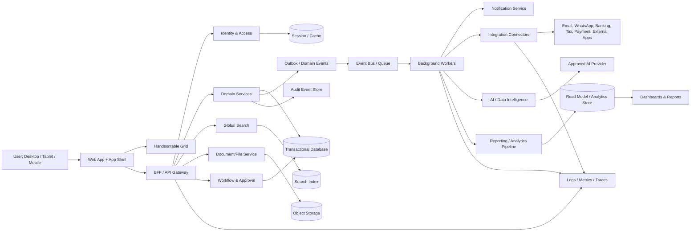

# PRD — SOP Integrated Business Management Platform

**Versi:** 1.1  
**Status:** Draft untuk alignment bisnis, UX, arsitektur, dan engineering  
**Tanggal:** 4 Oktober 2026  
**Platform:** Web responsive; desktop-first dengan dukungan tablet dan mobile  

> **Catatan:** “SOP” digunakan sebagai nama produk pada dokumen ini. Definisi resmi akronim, industri prioritas, negara operasi, dan kebutuhan compliance perlu dikonfirmasi pada fase discovery.

---

# 1. Overview

## 1.1 Masalah yang diselesaikan

Perusahaan menjalankan proses Sales, Business Development, Project, Procurement, Inventory, Finance, Corporate, dan Management menggunakan aplikasi, spreadsheet, email, serta WhatsApp yang terpisah. Kondisi ini menimbulkan masalah berikut:

- data customer, vendor, product, project, dan transaksi tersebar serta sering terduplikasi;
- status proses tidak konsisten antar departemen;
- approval manual sulit dipantau, terlambat, dan tidak memiliki jejak keputusan yang lengkap;
- dokumen memiliki banyak versi tanpa sumber dokumen yang jelas;
- komunikasi tidak selalu terhubung dengan customer, opportunity, project, quotation, invoice, atau approval;
- rekonsiliasi Sales, Project, Procurement, Inventory, dan Finance membutuhkan pekerjaan manual;
- laporan manajemen memerlukan konsolidasi yang lama dan berisiko salah;
- pemimpin tidak memiliki satu tampilan untuk revenue, pipeline, cash, AR/AP, project profitability, risiko, dan strategic initiative;
- AI dan data eksternal belum memiliki governance, provenance, permission, dan human approval yang memadai.

## 1.2 Tujuan utama aplikasi

SOP menjadi **single source of truth** untuk proses bisnis utama perusahaan dengan tujuan:

1. menyatukan data dan workflow lintas departemen;
2. mempercepat proses dari lead sampai payment dan dari purchase request sampai vendor payment;
3. menyediakan approval, escalation, notification, dan audit trail yang terukur;
4. memberi pengalaman pengolahan data yang familiar seperti spreadsheet melalui Handsontable;
5. memberikan visibility real-time atau near-real-time untuk operational team dan management;
6. mengurangi duplikasi input, pekerjaan rekonsiliasi, dan kesalahan administrasi;
7. menyediakan fondasi integrasi, automasi, AI assistant, dan data intelligence yang permission-aware.

## 1.3 Pengguna utama

| Pengguna | Kebutuhan utama | Modul utama |
|---|---|---|
| Executive/Director | Melihat KPI, cash, profitability, risiko, dan keputusan penting | Management, Reports, Executive Dashboard, Approvals |
| Super Admin | Mengelola tenant, user, role, konfigurasi, dan integrasi | Settings, Security, Integrations |
| Sales | Mengelola lead, opportunity, quotation, order, dan customer | CRM & Sales, Quotation, Sales, My Workspace |
| Business Development | Mengelola market, tender, partnership, proposal, dan competitor | Business Development, Data Intelligence |
| Finance/Accounting | Mengelola invoice, payment, AR/AP, journal, tax, cash, dan bank | Finance, Sales, Purchase, Reports |
| Project Manager | Mengelola scope, timeline, budget, team, cost, risiko, dan delivery | Project, Purchase, Inventory, Documents |
| Procurement | Mengelola PR, PO, vendor, contract, receipt, dan evaluation | Purchase, Inventory, Workflow |
| Warehouse/Inventory | Menjaga akurasi stok dan pergerakan barang | Inventory, Purchase, Sales |
| Corporate Secretary | Mengelola meeting, RUPS, resolution, dan corporate documents | General Meeting & RUPS, Corporate |
| Employee/Contributor | Menyelesaikan task, aktivitas, approval, dan komunikasi | My Workspace, Project, Communication |
| Auditor/Compliance | Meninjau transaksi, perubahan data, akses, dan dokumen | Security & Audit, Reports, Documents |
| Integration Admin | Menjaga koneksi dan job sistem eksternal | Integrations, Security, Settings |

## 1.4 First win (nilai pertama yang langsung dirasakan)

First win SOP adalah pengguna dapat membuka **My Workspace** dan langsung mengetahui:

- task dan follow-up yang harus dilakukan hari ini;
- approval yang menunggu keputusan;
- notification yang perlu ditindaklanjuti;
- project, quotation, invoice, atau PR yang mendekati deadline;
- dokumen dan komunikasi terakhir yang terkait dengan pekerjaan;
- shortcut untuk membuat activity, opportunity, quotation, PR, task, atau meeting.

Untuk bisnis, first win yang terukur adalah satu alur pilot berikut dapat diselesaikan tanpa spreadsheet atau perpindahan sistem:

`Lead → Opportunity → Quotation → Approval → Send → Sales Order`

Status, owner, dokumen, approval, komunikasi, dan audit trail harus terlihat di satu tempat.

## 1.5 Prinsip produk

1. **One record, many views:** satu record memiliki list, detail, timeline, dashboard, dokumen, dan aktivitas yang konsisten.
2. **Data first, not decoration:** tampilan mengutamakan keterbacaan, density, kecepatan scanning, dan kejelasan status.
3. **Excel-like, enterprise-safe:** grid terasa seperti spreadsheet tetapi transaksi tetap memiliki validasi, approval, versioning, dan audit.
4. **Explicit state:** status selalu menunjukkan owner, next action, deadline, SLA, dan alasan bila ditolak atau dibatalkan.
5. **Permission by default:** user hanya melihat data dan field sesuai company, branch, department, project, role, dan policy.
6. **Human-in-the-loop:** AI membuat draft, ringkasan, analisis, atau rekomendasi; aksi berdampak tinggi tetap memerlukan review manusia.
7. **Progressive disclosure:** informasi penting terlihat segera; detail lanjutan muncul melalui tab, drawer, atau drill-down.
8. **Responsive and accessible:** fungsi utama tersedia pada desktop, tablet, mobile, dan keyboard dengan fokus yang jelas.
9. **Auditability:** keputusan dapat ditelusuri berdasarkan siapa, kapan, apa yang berubah, dari sumber mana, dan mengapa.
10. **Configuration over customization:** numbering, approval, template, tax, notification, dan localization dapat dikonfigurasi tanpa mengubah kode.

## 1.6 Scope dan non-goals

### In scope

- business management lintas Sales, BD, Project, Purchase, Inventory, Finance, Corporate, Management;
- master data, document management, communication, workflow, approval, audit, dan integration;
- dashboard dan reports lintas fungsi;
- AI assistant dan data intelligence dengan governance;
- responsive UI dengan Handsontable sebagai komponen utama data grid.

### Non-goals versi awal

- menggantikan seluruh HRIS/payroll, banking core, atau sistem manufacturing;
- menjadi accounting statutory untuk semua negara tanpa konfigurasi lokal dan validasi compliance;
- menjalankan keputusan finansial, legal, pajak, atau kontraktual sepenuhnya otomatis;
- menganggap data hasil scraping selalu benar tanpa verifikasi dan provenance.

---

# 2. Requirements

## 2.1 Persyaratan Fungsional

### FR-01 Authentication dan account security

Sistem harus menyediakan Login, Forgot Password, Reset Password, Verify Email, Two-Factor Authentication, Account Locked, Session Expired, dan Logout.

Kebutuhan detail:

- login melalui email/username dan password;
- dukungan SSO/OIDC/SAML sebagai kemampuan integrasi;
- email verification dan reset password menggunakan token sekali pakai dengan expiration;
- password history, minimum strength, rate limiting, dan brute-force protection;
- 2FA melalui authenticator app dan metode yang diizinkan policy;
- account lock dengan reason, threshold, cooldown, dan admin recovery;
- session list, revoke single session, revoke all sessions, idle timeout, absolute timeout;
- login history, failed login, device, IP, dan security event masuk audit;
- draft yang sudah tersimpan tidak hilang ketika session expired.

### FR-02 Dashboard dan workspace

Sistem harus menyediakan Executive Dashboard, Sales Dashboard, Finance Dashboard, Project Dashboard, Procurement Dashboard, Inventory Dashboard, dan My Dashboard.

Setiap dashboard minimal mendukung:

- KPI value, target, variance, comparison period, trend, dan freshness timestamp;
- filter date, company, branch, department, project, owner, currency;
- drill-down dari KPI/chart ke list yang telah terfilter;
- widget loading, empty, stale, error, dan no-permission state;
- saved view, export, dan sharing sesuai permission;
- My Workspace untuk My Tasks, My Projects, My Approvals, My Activities, My Calendar, My Documents, My Notifications, My Email, dan My Profile.

### FR-03 CRM & Sales

Sistem harus mendukung Leads, Prospects, Customers, Contacts, Activities, Follow Up, Sales Pipeline, Sales Forecast, dan Customer History.

- lead capture manual, import, API, email, WhatsApp, web chat, dan data intelligence;
- deduplication berdasarkan email, phone, tax ID, dan matching rule;
- konversi lead ke prospect/customer/contact;
- owner, next action, priority, due date, reminder, dan SLA untuk activity/follow-up;
- pipeline stage, probability, amount, expected close, source, competitor, dan win/loss reason;
- weighted forecast, commit, best case, dan actual;
- customer 360 yang menghubungkan quotation, order, invoice, payment, project, communication, document, dan activity;
- account hierarchy dan multi-contact.

### FR-04 Business Development

Sistem harus mendukung Business Opportunities, Market Intelligence, Target Accounts, Prospect Mapping, Partnership, Tender & Bidding, Opportunity Pipeline, Competitor Analysis, Business Proposal, dan Business Development Reports.

- opportunity memiliki source, market, value, probability, timeline, owner, dan next step;
- target account dan prospect mapping berdasarkan industri, wilayah, segment, dan fit score;
- partnership dengan scope, PIC, agreement, status, dan review date;
- tender/bidding dengan deadline, requirement checklist, bid/no-bid decision, submission history, dan dokumen;
- competitor profile dengan evidence source dan win/loss analysis;
- proposal builder menggunakan document template dan template variables;
- report untuk opportunity, win rate, tender success, partner contribution, dan market trend.

### FR-05 Quotation

Sistem harus mendukung Quotation List, Create Quotation, Draft, Pending Approval, Sent, Negotiation, Approved, Rejected, Expired, Revision History, dan Quotation Templates.

- customer, contact, validity, currency, price list, tax, discount, delivery terms, payment terms;
- line item produk/jasa, quantity, unit, price, discount, tax, cost, margin, project, dan cost center;
- automatic numbering per company/branch/period;
- approval berdasarkan total, discount, margin, payment terms, atau exception;
- send via email/WhatsApp dengan delivery status;
- negotiation log, revision history, version immutable setelah sent/final;
- conversion quotation accepted menjadi Sales Order dengan traceability.

### FR-06 Sales transaction

Sistem harus mendukung Sales Order, Delivery/BAST, Invoice, Sales Return, Payment Receipt, Accounts Receivable, dan Sales Commission.

- Sales Order dari quotation atau manual sesuai permission;
- credit limit, stock availability, delivery schedule, project, dan exception approval;
- delivery/BAST dengan item, quantity, receiver, lokasi, evidence, dan signature;
- invoice dari order, delivery, contract, atau billing rule;
- partial payment, overpayment, allocation, receipt, dan reconciliation;
- return yang terhubung ke delivery/invoice dan mengatur stock/credit note;
- AR aging, collector, dispute, promise-to-pay, dan reminder;
- commission berbasis product, margin, collection, role, dan period;
- final transaction tidak diedit langsung; koreksi menggunakan adjustment, reversal, credit note, atau debit note.

### FR-07 Project management

Sistem harus mendukung Project List, Project Dashboard, Planning, WBS, Task & Subtask, Gantt Chart, Milestone, Team & PIC, Progress, Budget & RAB, Project Cost, Project Procurement, Project Documents, Project Communication, Project Risk, Project Issue, dan Project Profitability.

- project charter: scope, objective, customer, contract, dates, PM, team, status, dan health;
- WBS hierarkis dengan task, subtask, dependency, duration, estimate, assignee, predecessor;
- Gantt dengan baseline, current plan, actual, critical path, dan dependency conflict;
- milestone dengan acceptance criteria, due date, owner, approval, dan evidence;
- progress berbasis completion, deliverable, effort, atau weighted milestone;
- budget/RAB dengan quantity, unit cost, revenue, margin, contingency, dan cost center;
- project cost dari purchase, inventory issue, expense/time, dan adjustment;
- risk register dan issue register dengan severity, owner, mitigation, action, escalation;
- profitability dengan contract value, revenue, committed cost, actual cost, forecast cost, profit, dan margin;
- project close mensyaratkan deliverable, financial reconciliation, dan handover document.

### FR-08 Purchase dan vendor

Sistem harus mendukung Purchase Request, Purchase Order, Goods Receipt, Purchase Return, Vendors, Prices & Contracts, dan Vendor Evaluation.

- PR dengan requester, need-by date, item/service, justification, project/cost center, dan budget check;
- approval berdasarkan value, category, project, department, dan budget;
- PO dari approved PR, RFQ/vendor quotation, contract, atau direct purchase yang diizinkan;
- vendor price, lead time, tax, payment terms, delivery terms, warranty, dan validity;
- Goods Receipt dengan partial receipt, over/under delivery, quality, batch/serial, dan attachment;
- purchase return terhubung ke receipt/vendor invoice;
- vendor evaluation berdasarkan quality, price, timeliness, service, compliance, dan issue;
- three-way match PR/PO/GR/invoice bila diaktifkan;
- contract expiry dan price validity reminder.

### FR-09 Inventory

Sistem harus mendukung Stock, Stock Movement, Warehouse Transfer, Stock Opname, Stock Adjustment, Stock Card, Serial Number, Batch/Lot, dan Inventory Valuation.

- multi-company, multi-warehouse, bin/location, stock status available/reserved/quarantine/damaged;
- movement dengan source, destination, quantity, actor, reason, dan reference;
- reservation/allocation untuk Sales Order, Project, dan Purchase;
- warehouse transfer: request, approval, in-transit, receipt confirmation;
- stock opname: freeze/snapshot, count sheet, variance, recount, approval, adjustment;
- serial/batch/lot dengan expiry dan end-to-end traceability;
- stock card sampai source transaction;
- valuation configurable, misalnya moving average atau FIFO;
- negative stock dikontrol oleh policy.

### FR-10 Finance & Accounting

Sistem harus mendukung Transactions, Accounting, Cash & Bank.

- AR, AP, expense, journal, receipt, payment, transfer, adjustment;
- chart of accounts, journal entry, debit/credit validation, period, cost center, project, tax;
- posting rules dari Sales, Purchase, Inventory, Asset, Cash, dan Bank;
- period close/reopen dengan permission dan reason;
- cash/bank account, bank transaction, reconciliation, transfer, dan cash position;
- recurring transaction, allocation, multi-currency, exchange rate, realized/unrealized treatment;
- tax code, rate, inclusive/exclusive, withholding, dan report mapping;
- Trial Balance, General Ledger, P&L, Balance Sheet, Cash Flow, AR Aging, AP Aging, dan Tax Summary.

### FR-11 Reports & Analytics

Sistem harus mendukung Financial Reports, Tax Reports, Management Reports, Sales Reports, Purchase Reports, Project Reports, Inventory Reports, Asset Reports, Business Development Reports, KPI & Performance, Custom Reports, dan Analytics.

- parameter, filter, grouping, drill-down, saved view, export CSV/XLSX/PDF;
- target vs actual, variance, trend, comparison period;
- scheduling report ke email dengan access check;
- report definition memiliki owner, version, source, last refresh, dan freshness;
- custom report builder hanya dapat memilih field/join yang di-whitelist;
- dashboard analytics menunjukkan provenance, refresh timestamp, dan stale/error state.

### FR-12 Master data

Sistem harus mendukung Company Information, Chart of Accounts, Customers, Vendors, Products & Services, Assets, Departments, Employees, Warehouses, Pricing & Tax, Banks, Cost Centers, dan Others.

- unique code/key, active/inactive, effective date;
- import template, mapping preview, validation, duplicate check, error report;
- bulk update dengan impact preview;
- dependency warning sebelum archive;
- master data change history;
- approval untuk master yang kritikal seperti bank, COA, tax, pricing, dan vendor.

### FR-13 Document Management dan Template

Sistem harus mendukung All Documents, Project Documents, Quotation Documents, Sales Documents, Purchase Documents, Finance Documents, Company Documents, Document Templates, Document Versioning, Document Approval, Digital Signature, serta template untuk Quotation, Invoice, PO, SO, BAST, Contract, Proposal, Report, Letter, Email, WhatsApp, Kop Surat, Signature, Company Stamp, dan Template Variables.

- metadata: type, owner, confidentiality, retention, tags, related records;
- preview, upload, virus scan, version compare, superseded state, restore version;
- immutable version setelah dokumen dipakai pada transaksi final;
- approval, comment, rejection reason, approval stamp, digital signature status;
- template version, locale, effective date, scope, variable type, required/optional;
- conditional section untuk tax, discount, terms, approval, dan language;
- preview dengan sample data dan record nyata sesuai permission;
- branding dan company stamp configurable tanpa mengubah kode.

### FR-14 Email, Omnichannel, dan WhatsApp

Sistem harus mendukung Inbox, Sent, Draft, Starred, Archive, Trash, Email Compose, Email Threads, Email Attachments, Email Templates, Email Signature, Email Labels, Email Rules, Shared Mailbox, Email Integration, Unified Inbox, WhatsApp, Web Chat, Social Media, Customer Conversation, Assignment, Tags, Canned Response, Chatbot, Conversation History, Omnichannel Analytics, WhatsApp Accounts, Contacts, Broadcast, Message Templates, Automated Notification, Sales/Invoice/Payment Reminder/Project/Approval Notification, dan WhatsApp Bot.

- koneksi mailbox/provider via OAuth dan sync status;
- conversation terhubung ke customer, contact, opportunity, quotation, invoice, project, atau vendor;
- assignment, queue, SLA, priority, tag, internal note, dan handoff bot-to-human;
- broadcast dengan opt-in, segmentation, rate limit, delivery log, unsubscribe;
- template WhatsApp mengikuti approval/provider compliance;
- outbound notification memakai idempotency key agar tidak terkirim ganda;
- delivery, bounce, reply, attachment scan, dan retry log;
- analytics volume, first response, resolution, delivery, conversion, dan opt-out.

### FR-15 AI Assistant dan Data Intelligence

Sistem harus mendukung AI Chat, AI Business Assistant, AI Sales Assistant, AI Finance Assistant, AI Project Assistant, AI Procurement Assistant, AI Document Assistant, AI Report Assistant, Ask Your Data, Document Summarization, Document Generation, Data Analysis, Smart Recommendation, AI Workflow, AI Agent, Web Scraping, Data Sources, Scraping Jobs, Scraping Scheduler, Competitor Data, Market Data, Tender Data, Lead Data, Data Cleaning, Data Enrichment, Data Monitoring, dan Data Intelligence Dashboard.

Kebutuhan AI dan data eksternal:

- retrieval dan tool call selalu permission-aware;
- jawaban menyertakan source record, periode data, atau citation internal;
- data sensitif mengikuti redaction, retention, dan processing policy;
- output finansial, legal, pajak, kontrak, approval, dan komunikasi eksternal memerlukan human review;
- prompt, tool call, output, feedback, dan action execution diaudit sesuai policy;
- AI agent memiliki tool scope, action limit, approval gate, timeout, retry, dan kill switch;
- source registry menyimpan provider/URL, legal basis, owner, credential reference, dan refresh frequency;
- raw data dipisahkan dari cleaned/enriched data;
- setiap data eksternal memiliki source, collected_at, transformed_at, confidence, dan verification state;
- scraping memiliki rate limit, retry, schema monitoring, dan alert saat struktur sumber berubah;
- data eksternal tidak langsung mengubah master customer/vendor tanpa approval atau matching threshold.

### FR-16 Meeting, RUPS, Corporate, Management, Workflow, Security, dan Settings

Sistem harus menyediakan:

- **General Meeting & RUPS:** Meeting Dashboard, Meeting Agenda, General Meeting, RUPS Schedule, RUPS Agenda, Shareholders, Attendance, Voting, Resolutions, Minutes of Meeting, RUPS Documents, Meeting Resolutions, Action Items, Meeting Documents;
- **Corporate:** Corporate Calendar, Board Meeting, Management Meeting, RUPS, Corporate Resolutions, Corporate Documents, Action Items;
- **Management & Executive:** Executive Dashboard, Company KPI, Sales Performance, Financial Performance, Project Performance, Cash Position, Receivable Aging, Payable Aging, Pipeline Overview, Business Development, Strategic Initiatives, Executive Reports;
- **Workflow & Approval:** My Approval, Pending Approval, Approval History, Approval Workflow, Delegation, Escalation, Approval Matrix;
- **Integrations:** WhatsApp, Email/Outlook, Google Workspace, Microsoft 365, Payment Gateway, Banking, Tax/e-Faktur, API, Webhook, MQTT/IoT, External Applications;
- **Security & Audit:** User Activity, Audit Trail, Login History, Access Logs, Data Change History, Security Events, Session Management;
- **Settings:** Users & Access Control, Roles & Permissions, Approval Workflow, Document Numbering, Notifications, System Parameters, Localization, Email Configuration, WhatsApp Configuration, AI Configuration, Integration Settings, Backup & Restore.

### FR-17 Grid, bulk operation, search, dan notification

- Handsontable untuk inline editing, copy/paste, sorting, filtering, resize, selection, pagination/virtualization, validation, formula terkontrol, dropdown, checkbox, autocomplete, frozen row/column, context menu, dan data volume besar;
- perubahan inline dilakukan sebagai draft/staged change sampai commit berhasil;
- bulk edit/submit/approve menampilkan jumlah record, impact, permission, dan hasil per baris;
- global search permission-aware berdasarkan entity, number, name, email, phone, tag, status, owner, dan date;
- notification in-app, email, WhatsApp bila terhubung, dengan event, recipient rule, template, priority, quiet hours, deduplikasi, digest, retry, dan delivery log;
- operasi asynchronous memiliki progress, result file, failure reason, dan retry aman.

## 2.2 Persyaratan Non-Fungsional

### NFR-01 Performance

- p95 initial load halaman standar ≤3 detik pada target koneksi yang disepakati;
- p95 filter/sort server-side ≤2 detik untuk dataset paginated;
- validasi lokal inline edit memberi feedback ≤300 ms;
- grid menggunakan pagination/virtualization dan tidak memuat seluruh dataset ke browser;
- import, export, report, document generation, scraping, AI, dan notification job berjalan asynchronous.

### NFR-02 Availability dan reliability

- target availability, RPO, dan RTO ditentukan sebelum production launch;
- retry aman dan idempotency untuk payment, transaction, message, webhook, dan job;
- graceful degradation ketika provider eksternal down;
- backup/restore diuji berkala;
- error memiliki correlation ID dan tidak membocorkan secret.

### NFR-03 Security dan privacy

- encryption in transit dan at rest;
- tenant/company isolation;
- least privilege, RBAC + ABAC, field-level permission;
- MFA/SSO sesuai policy;
- protection terhadap XSS, CSRF, SQL injection, SSRF, brute force, malware upload;
- secret tidak disimpan di browser atau log;
- export/download/share/impersonation masuk audit;
- masking untuk data pribadi, bank account, tax ID, margin, dan secret;
- data retention, deletion, legal hold, dan access review dapat dikonfigurasi.

### NFR-04 Accessibility dan responsive

- target WCAG 2.2 AA untuk fungsi utama;
- keyboard navigation, visible focus, semantic labels, readable errors;
- status tidak mengandalkan warna saja;
- layout desktop, laptop, tablet, dan mobile;
- mobile memprioritaskan My Workspace, approval, notification, detail, quick action, upload, dan camera bila diperlukan;
- tabel lebar menggunakan horizontal scroll yang jelas atau mode card/list untuk mobile.

### NFR-05 Scalability dan observability

- multi-company, multi-branch, multi-currency, dan multi-timezone;
- asynchronous queue untuk operasi berat;
- read model/cache untuk dashboard;
- logs, metrics, traces, audit events, integration health, queue health, database health, dan frontend error monitoring;
- test volume dengan dataset realistis dan concurrent user target.

### NFR-06 Localization dan operability

- Bahasa Indonesia sebagai default dan siap English;
- format tanggal, angka, timezone, currency, tax, alamat, dan template configurable;
- feature flag, migration plan, rollback plan, maintenance banner, dan release note;
- admin dapat memeriksa health integration dan job tanpa akses database langsung.

---

# 3. Core Features berdasarkan FASE

## FASE 0 — Foundation dan Control Plane

**Tujuan:** membangun fondasi akses, data, dokumen, workflow, dan shell aplikasi agar modul berikutnya konsisten.

### Fitur inti

- Authentication dan account security;
- Users, Employees, Departments, Company, Branch, Warehouse, Cost Center;
- Roles & Permissions dengan RBAC + ABAC;
- App shell, navigation, global search, command palette, quick create;
- My Workspace versi awal;
- Master data core dan import engine;
- Document storage, metadata, attachment, preview, versioning dasar;
- Workflow & Approval engine;
- Notification center;
- Document numbering;
- Security event, audit trail, login history, session management;
- integration framework, job queue, feature flag, observability;
- backup/restore foundation.

### Exit criteria

- user dapat login, memiliki role, melihat menu sesuai permission;
- user dapat membuat draft record, submit approval, approve/reject, dan melihat history;
- perubahan data kritis memiliki audit trail;
- app shell dan grid pattern dapat dipakai ulang oleh modul lain;
- import master data memiliki preview, validation, duplicate check, dan error report.

## FASE 1 — Commercial Core

**Tujuan:** memberikan first win pada Sales dan Business Development.

### Fitur inti

- CRM & Sales: Leads, Prospects, Customers, Contacts, Activities, Follow Up, Sales Pipeline, Sales Forecast, Customer History;
- Business Development: Opportunities, Target Accounts, Prospect Mapping, Partnership, Tender & Bidding, Competitor Analysis, Proposal;
- Quotation: list, create, template, approval, send, negotiation, revision, expiry;
- Sales: Sales Order, Delivery/BAST, Invoice, Sales Return, Payment Receipt, AR, Commission;
- Sales Dashboard dan My Dashboard;
- email integration, email template, email thread;
- Document Template untuk quotation, invoice, SO, BAST, proposal, email;
- customer 360, activity timeline, notification, follow-up reminder.

### Exit criteria

- pilot Lead → Opportunity → Quotation → Approval → Send → Sales Order selesai end-to-end;
- quotation dan order memiliki nomor, status, owner, audit, dokumen, dan communication history;
- invoice dan payment dapat ditelusuri ke source transaction;
- dashboard Sales menampilkan pipeline, forecast, conversion, dan AR summary.

## FASE 2 — Delivery, Procurement, dan Inventory

**Tujuan:** menghubungkan komitmen penjualan dengan delivery, proyek, pembelian, biaya, dan stok.

### Fitur inti

- Project: planning, WBS, task/subtask, Gantt, milestone, team/PIC, progress;
- Project Budget & RAB, Project Cost, Project Procurement, Documents, Communication;
- Project Risk, Project Issue, Project Profitability;
- Purchase: PR, PO, GR, Purchase Return, Vendors, Prices & Contracts, Vendor Evaluation;
- Inventory: stock, stock movement, warehouse transfer, stock opname, adjustment, stock card, serial, batch/lot, valuation;
- Project, Procurement, Inventory Dashboard;
- approval matrix berbasis project, value, department, category, budget;
- document approval, BAST, goods receipt, dan vendor communication.

### Exit criteria

- PR → PO → GR dapat dilacak dan terhubung ke vendor/project/stock;
- stock movement, transfer, opname, dan adjustment tercatat lengkap;
- project PM dapat melihat baseline, progress, cost, risk, issue, dan profitability;
- purchase dan inventory menghasilkan data yang dapat digunakan Finance.

## FASE 3 — Finance, Management, Corporate, dan Omnichannel

**Tujuan:** menyediakan kontrol finansial, management visibility, governance, dan komunikasi multi-channel.

### Fitur inti

- Finance & Accounting: transactions, journals, AR/AP, cash & bank, reconciliation, tax;
- Reports & Analytics: financial, tax, management, sales, purchase, project, inventory, asset, BD, KPI, custom report;
- Executive Dashboard, Company KPI, Sales/Financial/Project Performance, Cash Position, AR/AP Aging;
- Strategic Initiatives dan Executive Reports;
- Corporate Calendar, Board Meeting, Management Meeting, RUPS, Resolution, Action Item, Corporate Documents;
- General Meeting & RUPS: agenda, shareholders, attendance, voting, minutes, documents;
- Omnichannel: unified inbox, email, WhatsApp, web chat, social media, assignment, tag, canned response, bot, analytics;
- integrations untuk payment gateway, banking, tax/e-Faktur, Google Workspace, Microsoft 365, Outlook.

### Exit criteria

- data Sales, Purchase, Inventory, dan Project dapat diposting atau direkonsiliasi ke Finance;
- manajemen dapat melihat cash, revenue, margin, AR/AP, pipeline, dan project performance;
- meeting/resolution/action item dapat ditelusuri sampai owner dan due date;
- komunikasi customer dapat dicari dan ditautkan ke entity bisnis.

## FASE 4 — AI, Data Intelligence, dan Advanced Automation

**Tujuan:** meningkatkan productivity dan decision support setelah data model, permission, dan audit stabil.

### Fitur inti

- AI Chat dan role-based Business/Sales/Finance/Project/Procurement/Document/Report Assistant;
- Ask Your Data dengan citation dan freshness;
- document summarization, generation, data analysis, recommendation;
- AI Workflow dan AI Agent dengan tool scope, approval gate, timeout, kill switch;
- Web Scraping, Data Sources, Scraping Jobs, Scheduler, Competitor/Market/Tender/Lead Data;
- cleaning, enrichment, monitoring, provenance, confidence, verification;
- advanced analytics dan anomaly/variance detection;
- MQTT/IoT dan external applications bila use case serta security review telah siap.

### Exit criteria

- AI dapat menjawab use case prioritas dengan source citation dan permission check;
- aksi AI berdampak tinggi selalu memiliki human approval;
- data eksternal memiliki provenance, freshness, confidence, dan verification state;
- AI/data job memiliki monitoring, cost/rate limit, error handling, dan audit.

---

# 4. User Flow

## 4.1 Flow autentikasi

```text
Open SOP
   ↓
Login
   ├─ Berhasil → 2FA bila aktif → cek session dan policy → My Workspace
   ├─ Gagal → retry/rate limit → account locked bila threshold tercapai
   ├─ Forgot Password → email token → Reset Password → Login
   └─ Belum verify → Verify Email → Login
```

## 4.2 Flow first win / My Workspace

```text
Login
  ↓
My Workspace
  ├─ Review Today: task, approval, follow-up, meeting, notification
  ├─ Open item → detail context → action/complete/delegate
  ├─ Quick Create → activity/opportunity/quotation/PR/task/meeting
  └─ Search global → open record → lihat timeline, documents, communications
```

## 4.3 Flow lead-to-cash

```text
Lead
  ↓ qualify
Prospect / Opportunity
  ↓ define value, probability, next action
Quotation Draft
  ↓ submit
Approval Matrix
  ├─ Request Changes → kembali ke owner
  ├─ Reject → closed dengan reason
  └─ Approve → send to customer
                    ↓
              Negotiation / Revision
                    ↓ accepted
              Sales Order
                    ↓
              Delivery / BAST
                    ↓
              Invoice
                    ↓
              Payment Receipt / Reconciliation
                    ↓
              AR Closed + Commission + Customer History
```

## 4.4 Flow procure-to-pay

```text
Purchase Request
  ↓ budget check + approval
Vendor Selection / RFQ
  ↓
Purchase Order
  ↓ vendor delivery
Goods Receipt
  ├─ Partial / Quality Issue → pending receipt or return
  └─ Complete → three-way match
                    ↓
              Vendor Invoice / AP
                    ↓ approval
              Payment / Reconciliation
                    ↓
              Vendor Evaluation + Stock/Project/Accounting Update
```

## 4.5 Flow project delivery

```text
Sales Order / Contract
  ↓
Create Project
  ↓
Charter → WBS → Baseline → Team/PIC → Milestone
  ↓
Execute Task / Procurement / Inventory / Communication
  ↓
Progress Update + Risk + Issue + Cost
  ↓ variance?
  ├─ No → continue delivery
  └─ Yes → alert / change request / approval
  ↓
Deliverable / BAST → Profitability → Handover → Close Project
```

## 4.6 Flow approval

```text
Record Draft
  ↓ submit
Evaluate Approval Matrix
  ↓
Pending Approval
  ├─ Approve → next step atau Finalized
  ├─ Request Changes → kembali ke requester dengan comment
  ├─ Reject → Rejected dengan reason
  ├─ Delegate → delegated approver dalam scope dan periode yang valid
  └─ SLA breach → reminder → escalation → audit event
```

## 4.7 Flow document dan signature

```text
Create / Upload Document
  ↓ metadata + related record + access scope
Draft Version
  ↓ submit
Document Approval
  ├─ Request Changes → new revision
  ├─ Reject → rejected dengan reason
  └─ Approve → Digital Signature bila dibutuhkan
                    ↓
              Final / Immutable Version
```

## 4.8 Flow AI assistant

```text
User prompt
  ↓
Permission check + intent classification
  ↓
Retrieve allowed data / call allowed tool
  ↓
Generate answer/draft/recommendation + source + freshness
  ├─ Informational → user reviews answer
  ├─ Draft → user edits and confirms
  └─ High-impact action → approval gate → execute → audit
```

---

# 5. Architecture

## 5.1 Lapisan utama

### 1. Experience layer

- responsive web application;
- app shell, navigation, dashboard, list/grid, board, form, detail, timeline;
- Handsontable data grid;
- command palette, global search, notification center, My Workspace;
- accessibility, localization, theme, density, keyboard shortcuts.

### 2. BFF/API layer

- authentication/session API;
- REST atau GraphQL untuk query/mutation yang sesuai;
- server-side validation, permission check, rate limit, idempotency;
- file upload/download signed URL;
- pagination, filtering, sorting, export job;
- API versioning dan correlation ID.

### 3. Domain/application layer

Domain service dipisah berdasarkan business capability:

- Identity & Access;
- CRM & Sales;
- Business Development;
- Quotation & Commercial;
- Project;
- Purchase & Vendor;
- Inventory;
- Finance & Accounting;
- Documents & Templates;
- Communication & Omnichannel;
- Meeting & Corporate;
- Workflow & Approval;
- Reports & Analytics;
- AI & Data Intelligence;
- Integration & Notification;
- Security & Audit.

### 4. Workflow dan event layer

- approval workflow engine;
- scheduler dan background job;
- event bus untuk domain event;
- notification dispatcher;
- integration worker;
- AI/data worker;
- outbox/inbox pattern untuk reliable event delivery.

### 5. Data layer

- relational transactional database;
- read model/analytics database atau warehouse;
- object storage untuk dokumen dan attachment;
- cache/session store;
- search index;
- audit/event store;
- backup dan disaster recovery storage.

### 6. Integration layer

- connector email/Outlook/Google Workspace;
- WhatsApp/provider messaging;
- payment gateway dan banking;
- tax/e-Faktur;
- e-signature;
- API/webhook;
- MQTT/IoT;
- external applications;
- secret management dan connection health.

### 7. Platform, security, dan observability layer

- CI/CD dan infrastructure as code;
- secret management, encryption, key rotation;
- centralized logs, metrics, traces, alerts;
- feature flag, configuration, migration, backup/restore;
- security scanning, dependency scanning, vulnerability management;
- audit, retention, data access review.

## 5.2 Diagram alur sistem



## 5.3 Diagram konteks data

```text
Master Data ──┬── CRM / Sales ── Quotation ── Sales Order ── Invoice ── Finance
              ├── Project ────── Cost / Budget ──────────────┘
              ├── Purchase ───── PO ── GR ── Inventory ─────┘
              ├── Documents / Templates / Signature
              ├── Communication / Omnichannel / Notification
              └── Reports / Management / AI / Data Intelligence

Workflow & Approval, Permission, Audit, dan Integration melintang di semua domain.
```

## 5.4 Struktur menu

```text
My Workspace
├── My Tasks
├── My Projects
├── My Approvals
├── My Activities
├── My Calendar
├── My Documents
├── My Notifications
├── My Email
└── My Profile

Dashboard
├── Executive Dashboard
├── Sales Dashboard
├── Finance Dashboard
├── Project Dashboard
├── Procurement Dashboard
├── Inventory Dashboard
└── My Dashboard

Commercial
├── CRM & Sales
│   ├── Leads / Prospects / Customers / Contacts
│   ├── Activities / Follow Up
│   ├── Sales Pipeline / Sales Forecast
│   └── Customer History
├── Business Development
├── Quotation
└── Sales

Delivery & Operations
├── Project
├── Purchase
└── Inventory

Finance & Insights
├── Finance & Accounting
├── Reports & Analytics
└── Management & Executive

Data & Documents
├── Master Data
├── Document Management
├── Document Template
├── Email & Communication
├── Omnichannel
└── WhatsApp Integration

Governance & Intelligence
├── Workflow & Approval
├── General Meeting & RUPS
├── Corporate
├── AI Assistant
└── Data Intelligence

Administration
├── Integrations
├── Security & Audit
└── Settings
```

## 5.5 Pola UX dan UI

### App shell

- left navigation yang dapat collapse;
- top bar dengan global search, command palette, quick create, notification, help, company switcher, profile;
- breadcrumb, title, status, owner, primary action, dan more action;
- right drawer untuk quick detail, timeline, approval, AI assistant, atau filter.

### Pola halaman

- **List:** title, count, saved views, toolbar, filter, grid, bulk action, pagination, export;
- **Detail:** summary header, status, key facts, tabs, related records, activity timeline, documents;
- **Form:** section, required marker, inline validation, draft, save, submit, submit-for-approval;
- **Dashboard:** KPI, chart, table drill-down, filter, freshness;
- **Board:** pipeline/status lane, drag-and-drop dengan permission check dan confirmation;
- **Approval center:** queue, due date, amount, requester, risk flag, context, decision action.

### Handsontable rules

- inline editing menghasilkan staged change sampai commit;
- validasi cell dan business rule berjalan sebelum commit;
- copy/paste dibersihkan dan divalidasi;
- field sensitif tidak dikirim ke client jika tidak berhak;
- formula hanya untuk use case yang diizinkan dan tidak melewati guardrail accounting/tax/stock;
- saved views menyimpan kolom, filter, sort, density, dan frozen state;
- grid menyediakan loading, empty, no result, partial error, read-only, stale, dan no-permission state.

## 5.6 Permission model

- **RBAC:** role menentukan view, create, edit, submit, approve, reject, export, delete/archive, configure;
- **ABAC:** policy berdasarkan company, branch, department, project, cost center, owner, amount, confidentiality, dan status;
- **Field-level permission:** margin, salary, bank account, tax ID, dan data personal dapat disembunyikan/read-only;
- **Separation of duties:** pembuat transaksi tidak otomatis dapat menyetujui transaksi yang sama;
- **Temporary access:** scope dan expiration tercatat dalam audit;
- **Data scope inheritance:** record terkait mengikuti scope parent bila policy mengaktifkan.

---

# 6. Database Schema

## 6.1 Konvensi schema

- primary key menggunakan UUID atau ULID;
- seluruh table bisnis memiliki `created_at`, `created_by`, `updated_at`, `updated_by`, `version`, dan bila diperlukan `archived_at`;
- transaksi memiliki `company_id`, `branch_id`, `status`, `owner_id`, `approval_state`, dan `source_reference`;
- angka keuangan menggunakan `numeric/decimal`, bukan floating point;
- waktu disimpan dalam UTC dan ditampilkan sesuai timezone user/company;
- kode/nomor transaksi unique berdasarkan scope numbering;
- perubahan status dan posting disimpan sebagai event/audit, bukan hanya overwrite field;
- attachment disimpan di object storage; database hanya menyimpan metadata dan reference;
- soft delete/archive untuk master dan content; transaksi final tidak dihapus;
- tenant/company isolation diterapkan pada setiap query bisnis.

## 6.2 Core schema — Identity dan organization

| Table | Kolom utama | Keterangan |
|---|---|---|
| `organizations` | `id`, `name`, `code`, `status`, `timezone`, `default_currency` | Tenant atau organization |
| `companies` | `id`, `organization_id`, `name`, `tax_id`, `address`, `status` | Legal/company entity |
| `branches` | `id`, `company_id`, `name`, `code`, `address`, `status` | Cabang/lokasi organisasi |
| `departments` | `id`, `company_id`, `parent_id`, `name`, `code`, `manager_id` | Struktur departemen |
| `employees` | `id`, `user_id`, `employee_no`, `department_id`, `title`, `status` | Profil internal |
| `users` | `id`, `email`, `name`, `status`, `last_login_at` | Identity user |
| `roles` | `id`, `organization_id`, `name`, `scope_type` | Role akses |
| `permissions` | `id`, `resource`, `action`, `field_scope` | Permission atomik |
| `user_roles` | `user_id`, `role_id`, `scope_json` | Assignment role + scope |
| `sessions` | `id`, `user_id`, `device`, `ip`, `expires_at`, `revoked_at` | Session aktif |

## 6.3 Core schema — CRM, commercial, dan project

| Table | Kolom utama | Keterangan |
|---|---|---|
| `leads` | `id`, `company_id`, `name`, `source`, `owner_id`, `status`, `score` | Lead awal |
| `customers` | `id`, `company_id`, `code`, `legal_name`, `tax_id`, `segment`, `status` | Customer/account |
| `contacts` | `id`, `customer_id`, `name`, `email`, `phone`, `role` | Kontak customer |
| `opportunities` | `id`, `customer_id`, `stage_id`, `value`, `probability`, `expected_close_at`, `owner_id` | Opportunity/pipeline |
| `activities` | `id`, `entity_type`, `entity_id`, `activity_type`, `owner_id`, `due_at`, `status` | Task/activity/follow-up |
| `quotations` | `id`, `number`, `customer_id`, `status`, `valid_until`, `currency`, `total`, `version` | Penawaran |
| `quotation_lines` | `id`, `quotation_id`, `product_id`, `description`, `qty`, `unit_price`, `tax`, `discount` | Detail quotation |
| `sales_orders` | `id`, `number`, `quotation_id`, `customer_id`, `status`, `total` | Order penjualan |
| `deliveries` | `id`, `sales_order_id`, `number`, `status`, `delivered_at`, `receiver` | Delivery/BAST |
| `invoices` | `id`, `number`, `customer_id`, `source_type`, `source_id`, `due_at`, `total`, `status` | Invoice AR/AP context |
| `payments` | `id`, `invoice_id`, `bank_account_id`, `amount`, `paid_at`, `status` | Receipt/payment |
| `projects` | `id`, `code`, `customer_id`, `contract_id`, `pm_id`, `start_at`, `end_at`, `status`, `health` | Project |
| `wbs_nodes` | `id`, `project_id`, `parent_id`, `name`, `sequence`, `baseline_start`, `baseline_end` | WBS |
| `tasks` | `id`, `project_id`, `wbs_node_id`, `assignee_id`, `status`, `progress`, `due_at` | Task/subtask |
| `milestones` | `id`, `project_id`, `name`, `due_at`, `acceptance_status`, `owner_id` | Milestone |
| `project_costs` | `id`, `project_id`, `source_type`, `source_id`, `amount`, `cost_date` | Cost project |
| `project_risks` | `id`, `project_id`, `probability`, `impact`, `score`, `mitigation`, `status` | Risk register |
| `project_issues` | `id`, `project_id`, `severity`, `root_cause`, `action`, `owner_id`, `status` | Issue register |

## 6.4 Core schema — procurement, inventory, finance

| Table | Kolom utama | Keterangan |
|---|---|---|
| `vendors` | `id`, `company_id`, `code`, `legal_name`, `tax_id`, `status` | Vendor |
| `purchase_requests` | `id`, `number`, `requester_id`, `project_id`, `need_by_at`, `status`, `total` | PR |
| `purchase_orders` | `id`, `number`, `vendor_id`, `purchase_request_id`, `status`, `total` | PO |
| `goods_receipts` | `id`, `number`, `purchase_order_id`, `warehouse_id`, `status`, `received_at` | GR |
| `warehouses` | `id`, `company_id`, `code`, `name`, `address`, `status` | Warehouse |
| `products` | `id`, `code`, `name`, `type`, `uom`, `track_serial`, `track_batch` | Product/service |
| `stock_balances` | `id`, `product_id`, `warehouse_id`, `location_id`, `qty_available`, `qty_reserved` | Saldo stok |
| `stock_movements` | `id`, `product_id`, `source_location_id`, `destination_location_id`, `qty`, `source_type`, `source_id` | Mutasi stok |
| `stock_counts` | `id`, `warehouse_id`, `count_date`, `status`, `approved_by` | Stock opname |
| `serial_numbers` | `id`, `product_id`, `serial_no`, `status`, `warehouse_id` | Serial |
| `batch_lots` | `id`, `product_id`, `lot_no`, `expiry_at`, `status` | Batch/lot |
| `accounts` | `id`, `company_id`, `code`, `name`, `type`, `parent_id` | Chart of accounts |
| `journal_entries` | `id`, `number`, `company_id`, `period`, `status`, `source_type`, `source_id` | Journal |
| `journal_lines` | `id`, `journal_entry_id`, `account_id`, `debit`, `credit`, `cost_center_id`, `project_id` | Detail journal |
| `bank_accounts` | `id`, `company_id`, `bank_name`, `account_no_masked`, `currency`, `status` | Bank/cash account |
| `bank_transactions` | `id`, `bank_account_id`, `value_date`, `amount`, `direction`, `reference`, `reconciliation_status` | Bank statement |
| `reconciliations` | `id`, `bank_account_id`, `period`, `status`, `completed_by` | Reconciliation |
| `tax_codes` | `id`, `company_id`, `code`, `rate`, `inclusive`, `effective_from`, `effective_to` | Tax configuration |
| `cost_centers` | `id`, `company_id`, `code`, `name`, `manager_id`, `status` | Cost center |

## 6.5 Core schema — workflow, documents, communication, audit

| Table | Kolom utama | Keterangan |
|---|---|---|
| `workflows` | `id`, `organization_id`, `entity_type`, `version`, `status`, `definition_json` | Definisi workflow |
| `approval_requests` | `id`, `entity_type`, `entity_id`, `workflow_id`, `status`, `current_step` | Approval run |
| `approval_steps` | `id`, `approval_request_id`, `approver_id`, `action`, `acted_at`, `comment` | Decision per step |
| `delegations` | `id`, `delegator_id`, `delegate_id`, `scope_json`, `starts_at`, `ends_at` | Delegasi |
| `documents` | `id`, `document_type`, `entity_type`, `entity_id`, `owner_id`, `confidentiality`, `status` | Metadata dokumen |
| `document_versions` | `id`, `document_id`, `version`, `storage_key`, `checksum`, `created_by`, `status` | Versi immutable |
| `document_templates` | `id`, `template_type`, `locale`, `version`, `definition`, `status` | Template |
| `signature_requests` | `id`, `document_id`, `provider`, `status`, `requested_at`, `completed_at` | E-signature |
| `mailboxes` | `id`, `owner_type`, `owner_id`, `provider`, `status` | Inbox/mailbox |
| `messages` | `id`, `mailbox_id`, `thread_id`, `direction`, `sender`, `recipients`, `sent_at` | Email/message |
| `conversations` | `id`, `channel`, `customer_id`, `assigned_to`, `status`, `priority` | Unified conversation |
| `conversation_messages` | `id`, `conversation_id`, `provider_message_id`, `direction`, `body_ref`, `delivery_status` | Message channel |
| `notifications` | `id`, `user_id`, `event_type`, `channel`, `status`, `sent_at`, `read_at` | Notification |
| `audit_events` | `id`, `actor_type`, `actor_id`, `action`, `entity_type`, `entity_id`, `diff_json`, `occurred_at` | Audit immutable |
| `security_events` | `id`, `severity`, `event_type`, `actor_id`, `ip`, `status`, `resolved_at` | Security event |
| `integration_connections` | `id`, `provider`, `scope_json`, `status`, `last_sync_at`, `secret_ref` | Connection |
| `integration_jobs` | `id`, `connection_id`, `job_type`, `status`, `attempt`, `error_ref`, `started_at` | Job integration |

## 6.6 Kamus

| Istilah | Definisi |
|---|---|
| Organization/Tenant | Batas isolasi data dan konfigurasi pada level platform |
| Company | Entitas legal/bisnis dalam organization |
| Branch | Cabang atau lokasi operasional company |
| Master data | Data referensi yang dipakai lintas transaksi |
| Source of truth | Sumber data resmi yang menjadi acuan lintas modul |
| Draft | Record yang belum dikunci atau difinalisasi |
| Pending Approval | Record yang menunggu keputusan pada workflow |
| Finalized/Post | Record yang sudah mengikat proses, saldo, atau laporan |
| Soft delete/Archive | Mengeluarkan record dari view aktif tanpa menghapus histori |
| WBS | Work Breakdown Structure untuk memecah scope project |
| RAB | Rencana Anggaran Biaya |
| BAST | Berita Acara Serah Terima |
| AR | Accounts Receivable/piutang |
| AP | Accounts Payable/hutang |
| RUPS | Rapat Umum Pemegang Saham |
| RBAC | Role-Based Access Control |
| ABAC | Attribute-Based Access Control |
| SLA | Service Level Agreement |
| Provenance | Informasi asal, waktu pengambilan, transformasi, dan verifikasi data |
| Idempotency | Jaminan request yang sama tidak membuat efek transaksi ganda |
| Read model | Bentuk data yang dioptimalkan untuk query/report/dashboard |
| Human-in-the-loop | Review atau approval manusia sebelum aksi berdampak tinggi dijalankan |

## 6.7 Diagram ER

```mermaid
erDiagram
  ORGANIZATIONS ||--o{ COMPANIES : contains
  COMPANIES ||--o{ BRANCHES : has
  COMPANIES ||--o{ DEPARTMENTS : has
  USERS ||--o{ USER_ROLES : assigned
  ROLES ||--o{ USER_ROLES : grants

  CUSTOMERS ||--o{ CONTACTS : has
  CUSTOMERS ||--o{ OPPORTUNITIES : owns
  LEADS ||--o| OPPORTUNITIES : converts_to
  OPPORTUNITIES ||--o{ ACTIVITIES : tracks
  CUSTOMERS ||--o{ QUOTATIONS : receives
  QUOTATIONS ||--o{ QUOTATION_LINES : contains
  QUOTATIONS ||--o| SALES_ORDERS : converts_to
  SALES_ORDERS ||--o{ DELIVERIES : fulfills
  SALES_ORDERS ||--o{ INVOICES : bills
  INVOICES ||--o{ PAYMENTS : receives

  CUSTOMERS ||--o{ PROJECTS : sponsors
  PROJECTS ||--o{ WBS_NODES : structures
  WBS_NODES ||--o{ TASKS : contains
  PROJECTS ||--o{ MILESTONES : tracks
  PROJECTS ||--o{ PROJECT_COSTS : incurs
  PROJECTS ||--o{ PROJECT_RISKS : has
  PROJECTS ||--o{ PROJECT_ISSUES : has

  VENDORS ||--o{ PURCHASE_ORDERS : receives
  PURCHASE_REQUESTS ||--o{ PURCHASE_ORDERS : becomes
  PURCHASE_ORDERS ||--o{ GOODS_RECEIPTS : receives
  WAREHOUSES ||--o{ GOODS_RECEIPTS : stores
  PRODUCTS ||--o{ STOCK_BALANCES : has
  PRODUCTS ||--o{ STOCK_MOVEMENTS : moves
  GOODS_RECEIPTS ||--o{ STOCK_MOVEMENTS : creates

  COMPANIES ||--o{ ACCOUNTS : owns
  JOURNAL_ENTRIES ||--o{ JOURNAL_LINES : contains
  ACCOUNTS ||--o{ JOURNAL_LINES : posts
  BANK_ACCOUNTS ||--o{ BANK_TRANSACTIONS : records
  BANK_ACCOUNTS ||--o{ RECONCILIATIONS : reconciles

  WORKFLOWS ||--o{ APPROVAL_REQUESTS : starts
  APPROVAL_REQUESTS ||--o{ APPROVAL_STEPS : contains
  DOCUMENTS ||--o{ DOCUMENT_VERSIONS : versions
  DOCUMENTS ||--o{ SIGNATURE_REQUESTS : signs
  CUSTOMERS ||--o{ CONVERSATIONS : communicates
  CONVERSATIONS ||--o{ CONVERSATION_MESSAGES : contains
  USERS ||--o{ NOTIFICATIONS : receives
  USERS ||--o{ AUDIT_EVENTS : acts
```



## 6.8 Aturan integritas data

- tidak boleh ada nomor transaksi duplicate dalam scope company/branch/period;
- quotation/sales order/invoice final tidak diubah langsung;
- journal debit dan credit harus seimbang sebelum posting;
- stock movement harus memiliki source/destination dan quantity valid;
- invoice/payment tidak boleh melampaui policy credit/overpayment tanpa exception;
- record yang terhubung ke transaksi final tidak boleh dihapus;
- setiap approval decision memiliki approver, timestamp, action, dan comment bila reject/request changes;
- foreign key dan tenant scope harus tervalidasi pada server, bukan hanya UI;
- import besar menggunakan staging table sebelum masuk tabel production.

---

# 7. Tech Stack

> Bagian ini adalah **rekomendasi awal**. Versi final ditetapkan setelah technical spike, volume test, security review, dan validasi kompetensi tim.

## 7.1 Rekomendasi stack

| Area | Rekomendasi | Alasan |
|---|---|---|
| Frontend | Next.js + React + TypeScript | Cocok untuk app shell, route/layout, server/client rendering, dan typed UI |
| UI styling | Tailwind CSS atau CSS Modules + design tokens | Konsistensi token, responsive layout, dan maintenance |
| Component system | Headless/accessibility-first primitives | Kontrol penuh atas focus, keyboard, state, dan visual density |
| Data grid | Handsontable React wrapper | Spreadsheet-like interaction sesuai kebutuhan produk |
| Form/validation | React Hook Form + Zod atau validator setara | Form kompleks, schema validation, dan reusable error state |
| Client data | TanStack Query atau setara | Cache, retry, invalidation, optimistic/staged update |
| Backend | NestJS + TypeScript atau service framework setara | Domain module, validation, guards, queues, events, dan testing |
| API | REST versioned; GraphQL opsional untuk read-heavy dashboard | REST lebih sederhana untuk transaction/integration; GraphQL dipakai selektif |
| Transaction DB | PostgreSQL | Relational integrity, transaction, reporting base, dan JSON field bila diperlukan |
| Cache/session | Redis atau managed equivalent | Session, cache, rate limit, distributed lock, queue support |
| Queue/event | Managed queue atau Kafka/RabbitMQ sesuai volume | Background job, integration retry, dan domain event |
| Object storage | S3-compatible object storage | Attachment, document, export, backup, dan signed URL |
| Search | OpenSearch/Elasticsearch atau managed search | Global search, full-text document search, filter cepat |
| Analytics | Read model PostgreSQL awal; warehouse/ClickHouse/BigQuery sesuai skala | Memisahkan workload dashboard dari transaksi |
| Auth | OIDC/SAML-compatible IdP atau managed identity service | SSO, MFA, session, federation, dan enterprise policy |
| AI | Model provider yang disetujui + retrieval/tool gateway internal | Permission-aware, citation, audit, dan provider portability |
| Document | Template engine HTML-to-PDF/DOCX + e-sign provider | Dokumen konsisten, template variable, dan signature workflow |
| Testing | Unit, integration, contract, E2E, permission, accessibility, load test | Risiko platform lintas domain tinggi |
| Observability | OpenTelemetry-compatible logs, metrics, traces | Satu correlation ID lintas API, worker, integration, dan UI |
| CI/CD | Containerized build + automated migration/test/security check | Deployment reproducible dan rollback terkontrol |

## 7.2 Catatan arsitektur teknis

### Modular monolith sebagai starting point

Disarankan memulai dengan modular monolith yang memiliki boundary domain kuat, bukan langsung memecah semua modul menjadi microservices. Alasannya:

- transaksi Sales, Inventory, Project, Purchase, dan Finance membutuhkan konsistensi data;
- tim dapat merilis lebih cepat tanpa overhead distribusi berlebihan;
- domain boundary tetap dapat diekstrak menjadi service ketika volume, ownership, atau isolation membutuhkan;
- event/outbox sejak awal menjaga kesiapan untuk asynchronous processing.

### Transactional path dan asynchronous path

**Synchronous:** login, permission check, create/update draft, approval decision, commit transaction, stock validation, posting validation.  
**Asynchronous:** email/WhatsApp, report generation, export, document rendering, OCR, scraping, AI generation, analytics refresh, webhook retry.

### API dan domain rule

- business rule berada di application/domain layer, bukan hanya di frontend;
- mutation memiliki idempotency key bila dapat diulang;
- API memiliki pagination, filter whitelist, sort whitelist, dan field selection yang aman;
- error response memiliki code, message aman, field error, correlation ID;
- optimistic update hanya untuk state yang tidak menimbulkan risiko transaksi; transaction commit menunggu server confirmation.

### Database dan consistency

- PostgreSQL menjadi source of truth untuk transaksi;
- FK, unique constraint, check constraint, transaction boundary, dan row-level policy diterapkan di server;
- event/outbox disimpan dalam transaksi yang sama dengan perubahan bisnis;
- read model diperbarui asynchronous dan menunjukkan freshness;
- laporan statutory mengambil snapshot/period yang dapat direproduksi.

### Document dan file security

- file diunggah melalui signed URL dan virus scan;
- database menyimpan metadata, checksum, owner, access scope, retention, dan storage key;
- akses file diperiksa ulang saat download/preview;
- final document version immutable;
- export diberi watermark bila confidentiality mengharuskan.

### Grid strategy

- server-side pagination/filter/sort untuk data besar;
- Handsontable hanya menerima field yang boleh dilihat user;
- staged change buffer mencegah perubahan diam-diam;
- import/paste masuk staging dan divalidasi sebelum commit;
- bulk operation memakai asynchronous job bila jumlah record melewati threshold;
- undo/redo dibatasi pada draft session dan tidak menjadi mekanisme reversal transaksi final.

### Workflow strategy

- definisi workflow berversi;
- workflow baru tidak mengubah approval run yang sedang berjalan;
- approver rule diselesaikan server-side berdasarkan snapshot context saat submit;
- delegation memiliki start/end date dan scope;
- escalation job idempotent dan seluruh reminder masuk log.

### AI dan data intelligence strategy

- AI tidak mengakses database secara langsung; semua akses melalui tool/retrieval gateway;
- gateway melakukan permission filter, row/field masking, source citation, rate limit, dan audit;
- tool yang mengubah data menggunakan dry-run/preview lalu confirmation/approval;
- prompt dan output sensitif mengikuti retention policy;
- scraping dipisahkan menjadi raw, cleaned, enriched, verified;
- ingestion job memiliki schema version dan dead-letter/error handling.

### Integration strategy

- setiap provider memiliki adapter dengan contract internal yang seragam;
- credential disimpan pada secret manager atau provider vault;
- webhook diverifikasi signature dan idempotency;
- outbound event memakai retry with backoff dan dead-letter queue;
- koneksi dapat pause/resume tanpa menghapus data historis;
- provider outage menampilkan health status dan manual fallback.

### Security baseline

- threat modeling per domain kritis;
- SAST, dependency scan, secret scan, DAST, penetration test sebelum production;
- audit log append-only dan tamper-evident;
- access review berkala;
- no secret pada log, client bundle, error response, prompt, atau export tanpa policy;
- data migration dan backup restore memiliki runbook serta drill.

---

# 8. Tambahan yang Diperlukan untuk PRD Lengkap

## 8.1 Acceptance criteria global

Fitur dianggap siap dirilis bila:

- happy path, validation, loading, empty, error, read-only, no-permission, dan mobile state tersedia;
- permission diuji minimal untuk requester, approver, admin, dan auditor;
- perubahan penting memiliki audit event;
- status transition memiliki guardrail dan automated test;
- notifikasi dan deep link bekerja atau memiliki failure state;
- export tidak membocorkan field yang tidak diizinkan;
- keyboard navigation dan focus state diverifikasi pada komponen utama;
- data volume realistis telah diuji;
- migration/backfill dan rollback plan tersedia bila schema/workflow berubah;
- dokumentasi user/admin dan release note tersedia.

### Definition of Done untuk transaksi

- nomor unik dan status valid;
- master data, total, tax, discount, currency, dan rounding tervalidasi;
- approval matrix selesai;
- source document dan attachment tersedia;
- posting/inventory/AR/AP/project impact berhasil atau error tercatat;
- timeline dan audit dapat dilihat;
- transaksi final tidak dapat diedit langsung.

## 8.2 Success metrics

### Adoption

- monthly active user per role;
- persentase transaksi inti yang dibuat di SOP;
- completion rate onboarding;
- penggunaan saved view, dashboard, grid filter, inline edit, dan bulk action.

### Efficiency

- waktu lead-to-quotation;
- waktu quotation approval;
- waktu PR-to-PO;
- waktu invoice-to-payment;
- waktu project reporting;
- persentase approval overdue;
- jumlah manual reconciliation dan duplicate entry.

### Quality dan control

- validation error rate;
- stock variance;
- PO/GR/invoice mismatch rate;
- audit completeness;
- integration failure/retry rate;
- notification delivery success;
- report freshness SLA;
- grounded answer rate dan human override rate untuk AI.

## 8.3 Risiko dan mitigasi

| Risiko | Dampak | Mitigasi |
|---|---|---|
| Scope terlalu luas | Delivery lambat dan kualitas turun | Rilis bertahap berdasarkan value dan dependency |
| Master data buruk | Laporan, search, dan automasi salah | Data steward, dedup, import validation, ownership |
| Approval terlalu kompleks | User bypass sistem | Mulai dari matrix sederhana, simulation, dan observability |
| Grid terlalu padat | Usability buruk | Saved view, density mode, progressive disclosure, mobile fallback |
| Integrasi provider berubah | Proses terhenti | Adapter layer, health check, retry, manual fallback |
| AI salah atau tidak grounded | Keputusan berisiko | Citation, permission check, confidence, human approval |
| Data scraping bermasalah | Risiko legal/reputasi | Source registry, legal review, rate limit, provenance |
| Migrasi spreadsheet gagal | Adopsi rendah | Pilot, mapping, staging, reconciliation, training |
| Dashboard stale | Keputusan keliru | Freshness timestamp, stale badge, source health |

## 8.4 Asumsi dan keputusan terbuka

- apakah model deployment single-tenant atau multi-tenant;
- apakah “SOP” memiliki arti resmi tertentu;
- industri, negara operasi, accounting standard, tax/e-Faktur, dan compliance target;
- struktur company/branch/department dan kebutuhan multi-currency;
- provider email, WhatsApp, banking, payment gateway, tax, storage, e-signature, dan AI;
- target user, concurrent user, record volume, attachment volume, RPO, RTO, availability;
- apakah payroll, HRIS, asset management, service desk, manufacturing, atau field service masuk roadmap;
- approval matrix awal dan separation-of-duties policy;
- data migration source serta source of truth untuk customer, product, COA, vendor, dan employee;
- kebutuhan offline mode atau mobile native;
- retention, legal hold, privacy, dan data residency.

## 8.5 Discovery plan

1. workshop proses dengan Sales, BD, Finance, Project, Procurement, Warehouse, Management, Corporate, dan IT;
2. inventaris spreadsheet, aplikasi, master data, dan laporan yang berjalan;
3. pilih 3–5 proses pilot dengan volume tinggi dan impact terukur;
4. validasi wireframe app shell, grid, detail, form, approval, dan dashboard;
5. uji prototype dengan role berbeda pada desktop, tablet, dan mobile;
6. susun permission matrix dan approval matrix sebagai artifact yang dapat ditinjau bisnis;
7. lakukan migration mapping, reconciliation, security review, dan integration spike;
8. definisikan backlog epic → feature → user story → acceptance criteria;
9. tetapkan baseline metric sebelum pilot agar first win dapat diukur.

---

# 9. Ringkasan Prioritas

SOP harus terasa sebagai satu sistem yang koheren, bukan kumpulan menu. Urutan prioritas produk:

1. user tahu pekerjaan yang perlu dilakukan hari ini;
2. setiap transaksi mudah dibuat, ditemukan, dipahami, dan ditelusuri;
3. data dapat dikelola cepat melalui grid yang familiar;
4. approval dan handoff antar fungsi tidak terputus;
5. management melihat KPI dengan sumber dan freshness yang jelas;
6. akses, audit, dokumen, dan AI aman sejak awal;
7. setiap fase menghasilkan nilai bisnis yang dapat diukur sebelum fase berikutnya diperluas.

Dokumen ini menjadi baseline untuk information architecture, wireframe, design system, technical design, backlog, test case, data migration, dan rencana implementasi bertahap.

